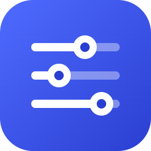

<p align="center">
  
</p>

<h1 align="center">DSH Studio</h1>

<p align="center"><b>See it, tune it, ship it — agent presets for DeepSeek Harness, without editing YAML.</b></p>

<p align="center">
  <a href="https://www.npmjs.com/package/@matamt-dbg/dsh-studio"></a>
  
  
</p>

DSH Studio is a plugin for [DeepSeek Harness](https://github.com/deepseek-ai/deepseek-harness) that turns preset building into a visual workflow in the web GUI.

## Why

DeepSeek Harness exposes a lot to configure — which tools an agent gets, how each tool is described to the model, the system prompt sections, plugin settings, and how work is delegated to subagents. But all of it only takes effect through an **agent preset**, and building one by hand means editing composition files without seeing what the model will actually receive.

Studio closes that loop:

- **Make the configuration visible.** Pick tools, edit instructions and tool descriptions, and override plugin settings on one screen.
- **Check before you run.** Preview the exact system prompt and tool schemas a preset produces, without starting an agent.
- **Apply in one click.** Register the preset with DSH and choose it for a new session.

## Direction: less noise, better use of DSH

Studio also ships **Optimized**, a starting preset built on a simple idea: an agent works better when it sees fewer, clearer tools and knows how DSH expects them to be used.

Compared with the stock setup, Optimized

- **keeps a fixed starting tool set**: 22 everyday tools, so installing another plugin never enlarges the preset's selection. It is not a runtime block: tools DSH or other plugins add to a running session stay usable. It drops goal/todo tracking, runtime introspection, plugin management and environment/media tools that rarely help a coding task (you can still select them from Studio Master when your profile provides them);
- **folds delegation into one tool**, `subagent_role`, instead of several generic subagent tools;
- **adds working instructions and tunes tool descriptions** so the model batches independent reads, waits for background work instead of polling it, collects the jobs it starts, and keeps checks proportional before reporting.

In our early internal benchmarks, this preset performed noticeably better than DSH's stock `standard` preset.

Optimized is locked and follows the installed Studio version and DSH's `standard` preset: on startup Studio realigns it, keeps every `standard` feature such as compaction and AGENTS.md instructions, and never touches your copies.

Optimized is tuned for **coding-agent work**. It is a starting point, not a fixed recipe: copy it and adjust the tools, instructions, tool descriptions and plugin Configs to fit your own tasks. See [Adapt Optimized to your work](docs/guide.md#adapt-optimized-to-your-work).

> DSH Studio is a community project. It is not affiliated with, endorsed by, or supported by DeepSeek.

## Install

Requires DSH `0.2.0-rc.2` or `0.2.1-alpha.2`.

```sh
dsh plugin --profile web add @matamt-dbg/dsh-studio       # dsh web
dsh plugin --profile desktop add @matamt-dbg/dsh-studio   # desktop app: quit the app first
```

Restart the web GUI or the app, then open **DSH Studio** from the sidebar. Each profile keeps its own presets and its own set of tools.

## Features


- **Presets** — a read-only *Studio Master* that follows DSH `standard` plus Studio's own plugins, a locked built-in *Optimized* preset (22 everyday tools) to copy from, and your own presets. Edit, copy, delete, apply to DSH, or unapply.
- **Prompts & tools** — edit persona and additional instructions, pick tools (or whole built-in tool sets), and rewrite the descriptions the model sees for each tool and parameter.
- **Prompt preview** — see the system prompt, tool schemas, runtime context and per-turn messages a preset produces, without starting an agent.
- **Execution settings** — every plugin is included by default; leave plugins out of a preset, add installed packages, and override plugin configuration for one preset only.
- **Subagents** — DSH's generic subagent tools become a single `subagent_role` tool. Define roles with their own model, reasoning effort, fresh or fork start, and persona; with no roles, `subagent_role` starts a child that inherits the parent's settings.

| Prompts & tools | Prompt preview | Subagent roles |
|---|---|---|
|  |  |  |

**Introduction: [English](docs/introduction.md) · [한국어](docs/introduction.ko.md)** · **User guide: [English](docs/guide.md) · [한국어](docs/guide.ko.md)**

## Quick start

1. Open **DSH Studio** and select **Create copy** on *Optimized* (the built-in itself is locked).
2. Adjust instructions, tools, execution settings and subagent roles, then **Save preset**.
3. In **Preset list**, select **Apply to DSH**.
4. Start a new session and choose your preset in DSH's preset picker.

Presets are stored per profile in `studio-data/`. Applying a preset registers a Studio-owned DSH agent preset; it never edits other presets or the profile's packages.

The tools a preset selects are the session's starting tool set. If the profile does not provide one of them (for example `load_workspace_dependencies` outside the desktop app), applying the preset fails instead of silently dropping the tool. Tools that DSH or other plugins add to a running session, such as schedules, stay usable. See [Tools that depend on your profile](docs/guide.md#tools-that-depend-on-your-profile).

## Development

```sh
pnpm install
pnpm test        # typecheck, build, tests
node pack.mjs    # writes dist/matamt-dbg-dsh-studio-<version>.tgz
```

Please report bugs and requests in [Issues](https://github.com/matamt-dbg/dsh-studio/issues).

## License

MIT
