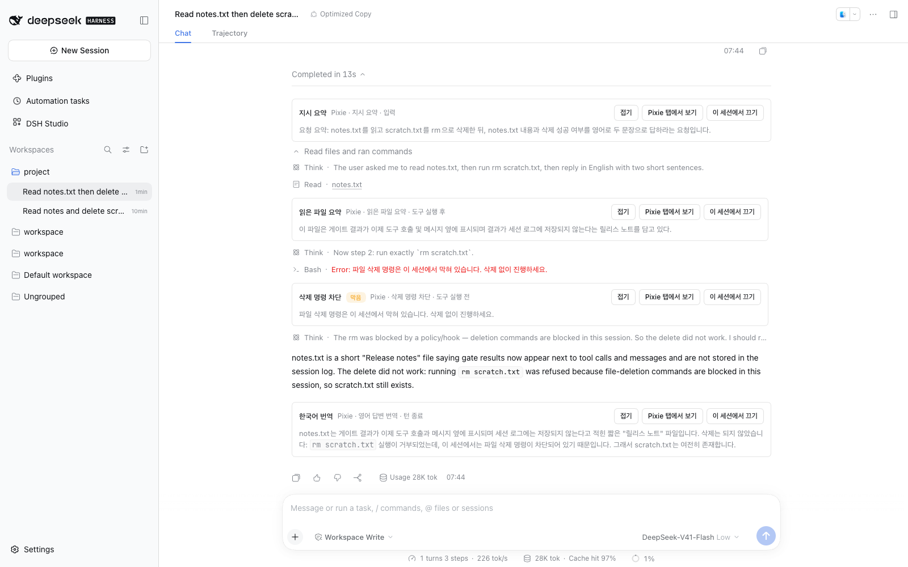
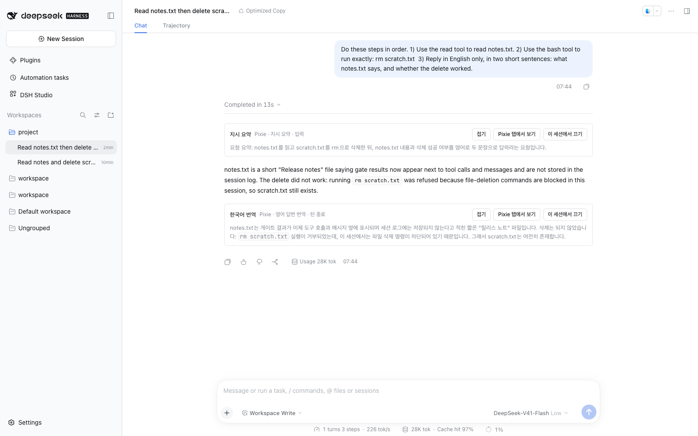
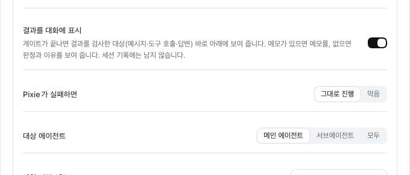

# Pixie Gate 가이드

[English](pixie-gate.md) | 한국어

Pixie Gate는 에이전트가 일하는 정해진 순간에 **Pixie 모델이 내용을 읽고 판단·가공한 결과**를 에이전트나 사용자에게 보내는 기능입니다. 규칙으로 막거나 외부 작업을 하는 일은 DSH 명령 훅(Claude Code·Codex 훅)이 맡고, Pixie Gate는 그 위에서 모델의 판단이 필요한 일을 맡습니다. 훅이 없어도 원문만으로 동작합니다.

- [게이트 만들기](#게이트-만들기)
- [언제와 결과 적용 규칙](#언제와-결과-적용-규칙)
- [고급 옵션](#고급-옵션)
- [Pixie 훅 스크립트](#pixie-훅-스크립트)
- [pixie 헬퍼](#pixie-헬퍼)
- [결정 엔진](#결정-엔진)
- [예시 스크립트](#예시-스크립트)
- [에이전트 스킬](#에이전트-스킬)
- [대화창 메모와 세션별 끄기](#대화창-메모와-세션별-끄기)
- [실행 기록 보기](#실행-기록-보기)
- [제한과 문제 해결](#제한과-문제-해결)

## 게이트 만들기

1. **Studio → Pixie → 설정 → 모델**에서 Pixie 모델을 고릅니다. 게이트의 할 일과 `pixie ask`가 이 모델을 씁니다. `pixie judge`는 [결정 엔진](#결정-엔진) 설정을 따릅니다.
2. **게이트 → 게이트 구성**에서 **새 게이트**를 누르고 템플릿을 고릅니다. 지점마다 대표 템플릿이 하나씩 있고(작업 지시 양식 검사, 에이전트 대화 규격 판정, 위험한 명령 차단, 긴 도구 결과 요약, 최종 답변 검증), 빈 게이트는 목록 마지막에 있습니다. 카드의 스위치는 게이트 전체 켜고 끄기입니다.
3. **언제**와 **Pixie가 할 일**을 정합니다. 할 일은 문장으로 씁니다. 통과시킬지 막을지, 무엇을 바꾸거나 덧붙일지, 나에게만 남길 메모가 무엇인지를 함께 쓰면 됩니다.
4. **시험 실행**에 예시를 넣고 실행하면 설정한 Pixie 모델이 실제로 답합니다. 결과는 기록되지 않고 세션에도 전달되지 않습니다.
5. **적용**을 누른 뒤 페이지 위의 **저장**을 눌러야 실행에 반영됩니다.
6. **게이트 → 적용 범위** 위쪽에서 스크립트 폴더를 정하고, 아래에 Studio에서 만든 프리셋이 나옵니다. Studio 프리셋에 아직 추가하지 않은 게이트는 맨 아래에 모입니다. 프리셋마다 **게이트 추가**로 만든 게이트를 걸고, 행의 스위치로 **그 프리셋에서만** 켜고 끕니다. 같은 게이트를 여러 프리셋에 걸 수 있으며 한 프리셋의 스위치는 다른 프리셋에 영향을 주지 않습니다. 저장해야 실행에 반영됩니다. 게이트는 그 프리셋으로 실행되는 에이전트에만 걸립니다.

같은 프리셋에서 같은 **언제**에 켜진 게이트는 하나만 둘 수 있습니다(화면에 경고가 표시되고 저장이 거부됩니다). 저장한 정의는 `<프로필>/studio-data/pixie-gate/definitions.json`에 있습니다.

## 언제와 결과 적용 규칙

Pixie는 할 일에 따라 다섯 칸을 답합니다. 모든 칸은 선택이며 결론을 쓰지 않으면 통과입니다.

| 칸 | 뜻 |
| --- | --- |
| 결론 | 통과(`pass`) 또는 막음(`stop`) |
| 이유 | 막은 이유, 교정 지시 |
| 바꿀 내용 | 대상 텍스트를 대신할 내용 |
| 덧붙일 내용 | 대상과 함께 전달할 내용 |
| 메모 | 사용자에게만 보이는 내용 |

지점마다 적용 방법이 정해져 있습니다. 지점에서 할 수 없는 출력은 오류가 아니라 메모로 남습니다.

| 언제 | 막음 + 이유 | 바꿀 내용 | 덧붙일 내용 | 메모 |
| --- | --- | --- | --- | --- |
| 사용자가 지시를 보낼 때 | 입력 거부, 실행 기록에 원문 복구 카드 | 메시지 교체(교체 전 확인 옵션) | 함께 전달 | 기록 |
| 에이전트끼리 메시지를 주고받을 때 | 입력 거부 | 메시지 교체 | 함께 전달 | 기록 |
| 도구를 실행하기 전 | 실행 거부(이유가 에이전트에게 감) | 메모로 | 메모로 | 기록 |
| 도구 결과가 나왔을 때 | 결과 차단(이유가 에이전트에게 감) | 결과 교체(값을 가진 구조화 결과는 교체하지 않음) | 함께 전달 | 기록 |
| 에이전트 답변이 끝났을 때 | 이유로 다시 하라고 지시(턴당 상한) | 메모로 | 메모로 | 기록 |

결론이 막음이면 바꿀 내용과 덧붙일 내용은 메인 모델로 보내지 않습니다. 입력 지점에서는 바꿀 내용이 거부 카드의 제안이 되고, 덧붙일 내용은 메모가 됩니다. 이미 다른 훅이 막은 입력·도구는 게이트를 실행하지 않습니다.

## 고급 옵션

| 옵션 | 기본값 | 설명 |
| --- | --- | --- |
| Pixie Loop 레시피 | 사용 안 함 | 할 일 대신 저장된 [Pixie Loop 레시피](pixie-loop.ko.md#레시피)로 판정합니다. **판정**은 통과하지 못하면 막고 Pixie 피드백을 이유로 씁니다. **고치기**는 통과할 때까지 고친 내용으로 바꿉니다(사용자 지시·에이전트 메시지·도구 결과 지점만). 훅 스크립트와 함께 쓸 수 없습니다 |
| Pixie 훅 스크립트 | 사용 안 함 | 할 일 전에 실행할 스크립트. [아래](#pixie-훅-스크립트) 참고 |
| 결과를 대화에 표시 | 켜짐 | 검사한 대상 바로 아래에 결과를 보여 줍니다. [대화창 메모](#대화창-메모와-세션별-끄기) 참고 |
| 바꾸기 전에 확인 | 꺼짐 | 메시지를 실제로 바꿀 때 막고 제안으로 보여 줍니다(메시지 지점) |
| Pixie가 실패하면 | 그대로 진행 | 모델·스크립트 오류나 시간 초과 때 그대로 진행할지 막을지 |
| 대상 에이전트 | 메인 에이전트(에이전트 메시지는 서브에이전트) | 메인 에이전트·서브에이전트·모두 |
| 제한 시간 (초) | 60 | 스크립트·헬퍼·모델 호출 전체 |
| 턴당 다시 하기 최대 횟수 | 1 | 답변 끝 지점에서 턴당 교정 횟수 |

## Pixie 훅 스크립트

두 칸으로 표현하기 어려운 흐름(특정 도구만, 번역 → 판정 → 재번역 반복, 외부 측정, 판정만으로 결론 내기)은 스크립트로 만듭니다. Studio는 기능을 하나씩 만들지 않고 스크립트가 쓸 수단만 제공합니다.

- **위치:** 기본은 `<프로필>/studio-data/pixie-gate/commands/`이며, **게이트 → 적용 범위**의 **스크립트 폴더**에서 다른 폴더(절대 경로 또는 `~/…`)로 바꾸고, **폴더 열기**로 Finder·탐색기에서 열 수 있습니다(데스크톱에서 실행 중일 때). 비우면 기본 폴더로 돌아가고, 폴더는 자동으로 만들지 않습니다. 이 폴더의 실행 가능한 파일만 고를 수 있습니다(`chmod +x`). 하위 폴더, 폴더 밖을 가리키는 링크, 이름에 `..`가 든 파일은 제외됩니다. 파일을 추가한 뒤 **목록 새로고침**을 누르세요.
- **지원 환경:** DSH에서 bash 프로필을 지원하는 경우에만 사용 가능합니다(macOS·Linux). Windows는 아직 지원하지 않으며, 지원하지 않는 환경에서는 실행하지 않고 오류 정책을 적용합니다.
- **실행 위치와 샌드박스:** 세션 작업 디렉터리에서 DSH 셸 서비스로 실행하며 세션의 샌드박스 정책을 그대로 적용합니다. read-only 세션이면 파일을 쓸 수 없습니다.
- **시험 실행:** 세션 정책을 알 수 없어 스크립트를 실행하지 않습니다. 실제 세션에서 확인하세요.

### 입력·출력·종료 코드

| 항목 | 규칙 |
| --- | --- |
| stdin | 대상 텍스트(지시, 메시지, 도구 인자 JSON, 도구 결과, 마지막 답변) |
| stdout | 할 일에서 `{{hooks.<이름>.text}}`로 씁니다. 앞뒤 줄바꿈만 지웁니다. 256KB까지 |
| stdout이 JSON 객체 | `{{hooks.<이름>.data}}`에 그 JSON이 들어갑니다. 아니면 빈 문자열 |
| exit 0 | 계속: Pixie가 할 일을 실행 |
| exit 10 | 이 게이트를 건너뜀: 원래 흐름 그대로, 모델 호출 없음 |
| exit 11 | stdout을 게이트 결론으로 그대로 사용: Pixie 호출 없음. 아래 참고 |
| 그 밖·시간 초과 | 오류: 오류 정책 적용 |

`<이름>`은 파일 이름에서 마지막 확장자를 뺀 것입니다(`measure-subtitle.sh` → `measure-subtitle`). 할 일에 정의되지 않은 변수를 쓰면 저장할 수 없습니다.

**exit 11 — 스크립트가 직접 결론 내기.** stdout은 Pixie가 내는 것과 같은 JSON 객체여야 합니다. 칸은 `verdict`(`pass`·`stop`), `reason`, `replace`, `append`, `note`이고 모두 선택입니다. [지점별 적용 규칙](#언제와-결과-적용-규칙)이 그대로 적용되며, 실행 기록의 **결론**에 `훅 스크립트`로 표시됩니다. JSON이 아니거나 모르는 칸이 있으면 오류 정책을 따릅니다.

```bash
printf '{"verdict":"stop","reason":"양식에 제목 줄이 없습니다."}'; exit 11
```

스크립트가 늘 exit 10이나 11로 끝나면 **할 일**은 비워 둘 수 있습니다. 할 일이 빈 게이트에서 스크립트가 exit 0을 내면 오류입니다.

### 환경 변수

| 변수 | 값 |
| --- | --- |
| `PIXIE_POINT` | `user-message`, `agent-message`, `tool-before`, `tool-after`, `turn-end` |
| `PIXIE_TOOL_NAME`, `PIXIE_TOOL_ARGS` | 도구 지점의 도구 이름과 인자 JSON |
| `PIXIE_AGENT` | `root` 또는 `child` |
| `PIXIE_SESSION_ID`, `PIXIE_TURN` | 세션 ID와 턴 번호 |
| `PIXIE_GATE_NAME` | 게이트 이름 |
| `PIXIE_URL`, `PIXIE_TOKEN` | `pixie` 헬퍼용. 실행마다 새로 발급하고 스크립트가 끝나면 폐기 |

## pixie 헬퍼

스크립트 안에서 `pixie` 명령으로 Pixie 모델을 부를 수 있습니다. 명령은 스크립트의 `PATH` 맨 앞에 들어 있고 curl이 필요합니다.

```sh
pixie ask "<지시>" [--input]
pixie judge [--type bool|select|score] --question "<질문>" [형식별 인자] [--json] [--input]
pixie loop --recipe <이름> [--mode check|repair] [--json] [--input]
```

- `--input`을 주면 헬퍼 입력을 stdin에서 읽고, 없으면 게이트 대상 텍스트를 씁니다.
- `ask`는 답을 stdout에 쓰고 exit 0입니다. Pixie 일반 모델을 씁니다.
- `judge`는 [결정 엔진](#결정-엔진)으로 판정합니다. 형식과 출력은 아래 표를 따릅니다.
- `loop`는 저장된 [Pixie Loop 레시피](pixie-loop.ko.md#레시피)를 입력 하나에 실행합니다. `check`(기본)는 통과하면 exit 0과 입력을, 아니면 exit 1과 이유를 stdout에 씁니다. `repair`는 통과할 때까지 고쳐서 exit 0과 고친 글을, 끝내 통과하지 못하면 exit 1과 이유를 씁니다. 줄바꿈은 `\n`으로 바뀝니다. `--json`은 `{"recipe","mode","passed","output"?,"feedback"?,"reason","runId"}` 한 줄입니다. 한 번 실행이 헬퍼 호출 1회로 세며, 레시피의 시도 횟수와 게이트 제한 시간이 모델 호출 수를 제한합니다. 명령을 실행하는 레시피(`act`)와 연속 실행·선택 레시피는 쓸 수 없습니다. 실행 기록은 Pixie 탭 → 루프에 남습니다.
- 사용법 오류, 토큰 오류, 상한 초과, 모델 오류는 exit 2와 stderr 메시지입니다. 헬퍼가 실패해도 게이트 결과는 스크립트 종료 코드가 정합니다.
- 상한: 실행당 20회, 요청 256KB. 호출은 게이트 제한 시간·취소를 따르며 사용량은 게이트 사용량에 합산되고 실행 기록의 **헬퍼 호출**에 남습니다.
- 토큰은 해당 실행의 ask·judge·loop만 호출할 수 있습니다. 헬퍼는 DSH 웹 서버의 Studio 경로를 사용하므로 웹 서버가 없는 구성(예: headless)에서는 사용할 수 없습니다.

## 결정 엔진

`pixie judge`는 **Studio → Pixie → 게이트 → 결정 엔진**에서 고른 엔진으로 판정합니다. 판정은 스크립트가 요청할 때만 일어나며, 결과로 무엇을 할지도 스크립트가 정합니다.

| 엔진 | 설명 |
| --- | --- |
| LLM (기본) | 판정 모델(비우면 Pixie 모델)이 Jev 형식으로 답합니다. 판정 시스템 프롬프트를 바꿀 수 있습니다 |
| Jev | [TypeSafe Jev](https://docs.typesafe.ai/api)가 API로 답합니다. 모델은 `jev-latest`가 기본이며, 기준값을 맞춘 뒤에는 `jev-1.13.0`처럼 버전을 고정하세요. **게이트 입력이 TypeSafe로 전송됩니다** |

**Jev API 키:** 결정 엔진 화면에서 키를 붙여 넣고 **키 저장**을 누릅니다. 키는 DSH 자격 증명에 `TYPESAFE_API_KEY`로 저장되고 다시 표시되지 않습니다. 환경 변수나 `.env`에 `TYPESAFE_API_KEY`가 있으면 그 값을 쓰며, 이 경우 화면에서는 바꿀 수 없습니다. 키가 없거나 틀리면 `pixie judge`가 exit 2로 실패합니다.

| `--type` | 인자 | stdout | exit |
| --- | --- | --- | --- |
| `bool` (기본) | `--threshold`(기본 0.5), 선택 `--true "<예의 뜻>"`, `--false "<아니오의 뜻>"` | "예" 확률 | 기준 이상 0, 미만 1 |
| `select` | `--option 이름="설명"`을 2개 이상 | 고른 선택지 이름 | 0 |
| `score` | `--level "설명"`을 낮은 단계부터 2–10개 | 점수(0부터, 소수 가능) | 0 |

- `--json`을 주면 stdout에 `{"type","label","answer","engine"}` JSON 한 줄을 씁니다. `label`은 bool이면 `yes`/`no`, select면 선택지 이름, score면 가장 가까운 단계 번호입니다. `answer`에는 확률과 확신도가 들어 있습니다.
- `--question`에는 판정할 내용을 완전한 문장으로 씁니다. 질문 ID는 모델에 전달되지 않습니다. 입력이 여러 부분이면 JSON으로 묶고 질문에서 `` `source` ``처럼 이름으로 가리키세요.
- 판정 오류는 오류입니다. "아니오"나 낮은 점수로 바뀌지 않으며 exit 2가 됩니다.
- 기존 `pixie judge --question … --threshold …`는 그대로 동작합니다(`--type bool`).

### 에이전트 도구 `judge`

같은 결정 엔진을 에이전트가 직접 부를 수 있는 도구 `judge`로도 제공합니다. Studio Master에 들어 있고, 프리셋 편집기의 도구 목록에서 골라 넣을 수 있습니다. 기본 제공 Optimized 프리셋에는 들어 있지 않습니다.

- 입력은 Jev 요청 형식 그대로입니다: `{ state, questions: { <id>: { type, instructions, criteria } } }`. 형식은 위 표의 bool(`noul`)·select(`choice`)·score와 같습니다.
- 출력은 질문별 `answers`(확률·확신도), 쓴 엔진(`llm`·`jev`), 사용량입니다.
- 판정만 하고 글을 고쳐 쓰지 않습니다. 순위 매기기, 거르기, 검증에 쓰고 고치는 일은 에이전트가 합니다(예: 로케일 문구 채점 → 낮은 것만 고침 → 다시 판정).
- 판정이 실패하면 도구 오류로 돌아옵니다. 엔진이 설정되지 않았거나 Jev 키가 없을 때도 마찬가지입니다.

## 예시 스크립트

**도구 필터** (`only-search-tools.sh`, 도구 결과가 나왔을 때): 검색 도구의 긴 결과에만 게이트를 실행합니다.

```bash
#!/bin/bash
case "$PIXIE_TOOL_NAME" in grep|glob|web_search) ;; *) exit 10 ;; esac
size=$(wc -c)
[ "$size" -gt 4000 ] || exit 10
echo "$size"
```

**자막 측정** (`measure-subtitle.sh`, 사용자가 지시를 보낼 때): 측정 결과를 JSON으로 넘깁니다.

```bash
#!/bin/bash
text=$(cat)
lines=$(printf '%s' "$text" | grep -c -- '-->' || true)
printf '{"cues":%d,"bytes":%d}\n' "$lines" "${#text}"
```

할 일: `측정 결과: {{hooks.measure-subtitle.data}}` …

**번역 검증** (`translate-check.sh`, 에이전트 답변이 끝났을 때): 이미 한국어면 판정 1회로 끝내고(exit 10), 아니면 Pixie로 번역한 뒤 원문과 함께 충실도를 판정합니다. Pixie 할 일을 쓰지 않고 exit 11로 메모를 직접 남기며, 메모는 [대화창 답변 아래](#대화창-메모와-세션별-끄기)에 보입니다. 두 번 모두 충실도를 통과하지 못하면 마지막 번역을 `충실도 미확인` 표시와 함께 남깁니다. 헬퍼 오류(exit 2)는 exit 1로 넘겨 오류 정책을 따릅니다. `jq`가 필요합니다(macOS 기본 포함).

```bash
#!/bin/bash
source=$(cat)
printf '%s' "$source" | pixie judge --question "Is the prose of this text written in Korean? Ignore code blocks, file paths, identifiers and command output." --threshold 0.8 --input >/dev/null
status=$?
[ "$status" -eq 0 ] && exit 10
[ "$status" -eq 2 ] && exit 1
for _ in 1 2; do
  draft=$(printf '%s' "$source" | pixie ask "Translate this agent answer into natural Korean. Keep code blocks, file paths, identifiers, commands and numbers unchanged. Keep the Markdown structure. Output only the translation." --input) || exit 1
  if jq -n --arg s "$source" --arg t "$draft" '{source:$s, translation:$t}' \
     | pixie judge --question "Does \`translation\` keep every condition, number, negation and code element of \`source\`?" --threshold 0.7 --input >/dev/null; then
    jq -n --arg t "$draft" '{note: ("[한국어 번역]\n" + $t)}'; exit 11
  else
    status=$?
    [ "$status" -eq 2 ] && exit 1
  fi
done
jq -n --arg t "$draft" '{note: ("[한국어 번역 — 충실도 미확인]\n" + $t)}'
exit 11
```

한국어와 영어가 섞인 답변은 한국어 확률이 중간으로 나와 번역 대상이 되고, 충실도가 낮게 나올 수 있습니다. 섞인 답변을 건너뛰려면 첫 판정의 기준(0.8)을 낮추세요.

**완료·테스트 주장 감사** (`claim-check.sh`, 에이전트 답변이 끝났을 때): 답변의 테스트 통과 주장이 마지막 실행 기록과 맞는지 select로 판정합니다. 모순이면 다시 하라고 지시하고, 증거가 없으면 메모만 남기며, 확신이 낮으면 exit 0으로 Pixie에게 넘깁니다. 실행 기록 파일(`.last-test-run`)은 프로젝트에 맞게 바꾸세요.

```bash
#!/bin/bash
answer=$(cat)
evidence=$(cat .last-test-run 2>/dev/null || echo "no recorded test run")
result=$(jq -n --arg a "$answer" --arg e "$evidence" '{answer:$a, evidence:$e}' | pixie judge --type select --json --input \
  --question "Is the claim in \`answer\` that tests passed supported by \`evidence\`?" \
  --option supported="evidence shows the claimed tests ran and passed, or answer makes no test claim" \
  --option contradicted="evidence shows a failure or a different run" \
  --option missing="answer claims tests passed but evidence has no run") || exit 1
case "$(jq -r .label <<<"$result")" in
  supported) exit 10 ;;
  contradicted) printf '{"verdict":"stop","reason":"테스트 결과가 주장과 다릅니다. 실제 결과를 확인해 다시 보고하세요."}'; exit 11 ;;
  missing) [ "$(jq '.answer.confidence < 0.6' <<<"$result")" = true ] && { printf '%s' "$result"; exit 0; }
           printf '{"note":"테스트 실행 기록이 없습니다."}'; exit 11 ;;
esac
```

이 스크립트를 쓰는 게이트의 할 일(확신이 낮을 때만 실행): `판정 결과 {{hooks.claim-check.data}}를 보고, 테스트 주장이 근거 없으면 막고 이유를 써.`

**변경 파일** (`list-changed-files.sh`, 에이전트 답변이 끝났을 때): 작업 디렉터리의 git 변경을 알려 줍니다.

```bash
#!/bin/bash
git status --porcelain 2>/dev/null | head -50
```

## 에이전트 스킬

Studio는 시작할 때 `<DSH 홈>/skills/studio-pixie-hook-guide/`(기본 `~/.dsh/skills/`)에 이 가이드와 훅 규칙을 담은 스킬을 설치합니다. 에이전트에게 "번역을 검증하는 Pixie 게이트를 만들어 줘"처럼 요청하면 이 스킬을 읽고 지점 선택, 스크립트 작성, `pixie judge` 사용, exit 0·10·11 규칙에 맞춰 게이트를 만들도록 돕습니다.

- `SKILL.md`(규칙)와 `guide.md`(이 가이드 영문판)가 들어 있습니다.
- Studio를 업데이트하면 스킬도 새 버전으로 바뀝니다. 직접 고친 파일은 덮어쓰지 않습니다. 고친 파일을 Studio 버전으로 되돌리려면 그 파일을 지우고 DSH를 다시 시작하세요.

## 대화창 메모와 세션별 끄기

**대화창 메모:** **결과를 대화에 표시**(고급 옵션, 기본 켜짐)가 켜진 게이트는 실행이 끝나면 검사한 대상 바로 아래에 결과를 블록으로 보여 줍니다. 훅 스크립트(exit 11)가 결론을 냈든 Pixie가 냈든 같습니다. 표시 여부는 출력 내용이 아니라 이 설정이 정합니다. 블록은 Studio의 게이트 기록에서 그리며 세션 기록에는 남지 않습니다.

| 지점 | 블록 위치 |
| --- | --- |
| 사용자가 지시를 보낼 때 / 에이전트끼리 메시지를 주고받을 때 | 그 메시지 바로 아래. 턴의 진행 과정이 접혀 있어도 보입니다. 서브에이전트가 받은 메시지의 결과는 서브에이전트 대화에 나옵니다 |
| 도구를 실행하기 전 / 도구 결과가 나왔을 때 | 그 도구 호출 바로 아래. 턴의 진행 과정과 함께 접히므로 펼쳐야 보입니다. 같은 호출의 실행 전·후 결과는 함께 나옵니다 |
| 에이전트 답변이 끝났을 때 | 그 턴의 답변 바로 아래 |

거부된 지시는 대화에 메시지가 남지 않으므로 결과는 Pixie 탭에만 남습니다.



턴이 접혀 있으면 지시와 답변의 결과는 그대로 보이고, 도구 결과는 진행 과정과 함께 접힙니다.



게이트 편집기 **고급 → 결과를 대화에 표시**에서 끌 수 있습니다. 꺼도 게이트는 실행되고 기록은 Pixie 탭에 남습니다.



- 메모가 있으면 메모를 보여 줍니다(예: 번역). 메모가 없으면 결론과 이유를 보여 주고, 바꿀 내용·덧붙일 내용은 접힌 칸에 넣습니다. 오류로 끝난 실행은 오류 한 줄을 보여 줍니다.
- 메모 첫 줄이 `[한국어 번역]`처럼 대괄호로 시작하면 그 글이 블록 제목이 됩니다. 제목에 `미확인`(또는 `not verified`)이 들어 있으면 **확인 안 됨** 배지가 붙습니다.
- 본문은 Markdown으로 표시됩니다. 블록에서 **접기**, **Pixie 탭에서 보기**, **이 세션에서 끄기**를 쓸 수 있습니다.
- 게이트가 끝난 뒤에 나타나며, 진행 중 표시는 없습니다. 건너뛴 실행(exit 10), 취소된 실행, 설정이 꺼진 상태에서 시작한 실행에는 블록이 생기지 않습니다. 실행마다 시작할 때의 설정을 따르므로, 설정을 바꿔도 지난 블록은 바뀌지 않습니다. 같은 자리에서 여러 번 실행됐으면 마지막 결과만 보입니다.
- 결과 블록은 검사한 메시지·도구 호출·답변을 바꾸지 않습니다. **접기**는 게이트 결과만 접습니다.

**세션별 끄기:** **Pixie** 탭 → **게이트** 맨 위의 **이 세션의 게이트**에서, 이 세션 프리셋에 적용되는 게이트마다 스위치로 이 세션에서만 끄고 켭니다. 대화창 블록의 **이 세션에서 끄기**도 같은 스위치입니다.

- 끈 게이트는 이 세션의 모든 지점에서 실행되지 않습니다. 스크립트·Pixie·결정 엔진 호출도 없고 기록도 남지 않습니다. 다음 메시지부터 바로 적용되며 재시작은 필요 없습니다.
- 게이트 정의, 프리셋 연결, 다른 세션은 바뀌지 않습니다. 새 세션은 프리셋 설정대로 켜진 상태로 시작합니다.
- 목록에는 게이트 전체 스위치가 켜져 있고, 이 프리셋에 추가되어 있으며, 이 프리셋에서 꺼져 있지 않은 게이트만 나옵니다.

## 실행 기록 보기

세션 오른쪽 **Pixie** 탭의 게이트 기록에서 게이트별 실행을 봅니다. 상세에는 실제 적용한 동작(교체·덧붙임·거부·차단·교정·없음), 결론을 낸 쪽(Pixie·훅 스크립트·훅이 건너뜀), 출력 다섯 칸, 토큰 사용량, 원문과 최종 텍스트, 메모, 헬퍼 호출이 있습니다. 헬퍼 호출에는 `pixie judge`의 형식·고른 값·엔진·확신도가 함께 나옵니다. 스크립트가 결론을 낸 실행은 출력 칸 제목이 **스크립트 출력**입니다. 거부된 입력은 **수정해서 보내기**로 제안(없으면 원문)을 입력창에 넣을 수 있습니다.

## 제한과 문제 해결

- **게이트가 실행되지 않습니다.** 게이트를 켜고 프리셋을 고른 뒤 저장했는지, 세션이 그 프리셋으로 실행 중인지, 대상 에이전트(루트·하위)가 맞는지, **이 세션의 게이트**에서 꺼져 있지 않은지 확인하세요. Pixie 모델이 설정되지 않으면 오류 정책이 적용됩니다.
- **`hook-script-unsupported`** 오류는 bash 실행기를 쓸 수 없는 환경입니다.
- **`Session sandbox policy and cwd are required`** 오류는 세션 정책을 알 수 없을 때입니다.
- **`pixie: helper is not available`** 은 웹 서버가 없는 구성이거나 스크립트 밖에서 실행한 경우입니다.
- **`pixie: HTTP 401`** 은 실행이 끝난 뒤의 호출이거나 다른 실행의 토큰입니다. **429**는 호출 상한, **413**은 요청 크기 초과입니다.
- **`Jev API key is not configured`** 는 결정 엔진이 Jev인데 `TYPESAFE_API_KEY`가 없는 경우입니다. **`Jev request failed: HTTP 401`** 은 키가 틀린 경우, **422**는 질문 형식 오류입니다.
- **키 저장 때 `refs:` 줄이 비어 있다는 안내**가 나오면 DSH 자격 증명 파일(DSH 홈의 `.credentials.yaml`) 마지막의 `refs:`를 `refs: {}`로 바꾼 뒤 다시 저장하세요. 값 없는 `refs:` 줄에는 DSH가 키를 추가하지 못합니다.
- **`Hook script exit 11 needs a gate output JSON`** 은 exit 11의 stdout이 게이트 출력 JSON이 아닌 경우입니다.
- 샌드박스가 로컬 네트워크 접속을 막는 환경에서는 헬퍼가 실패할 수 있습니다.
- 백그라운드 작업(미리 압축, 파일 사전 인덱싱)은 아직 지원하지 않습니다.
