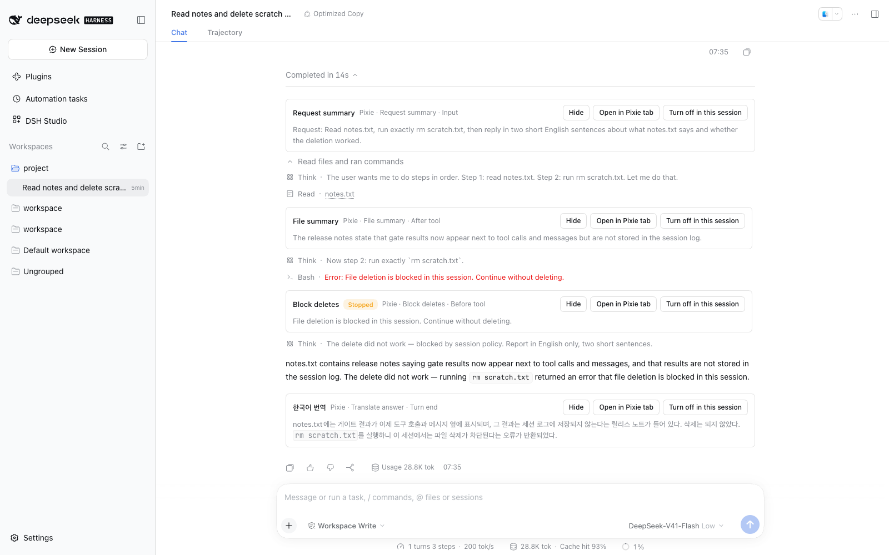
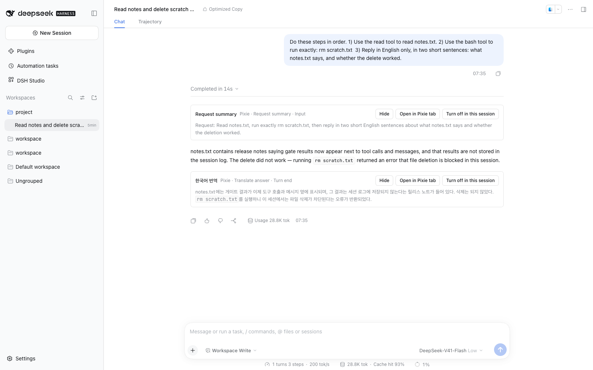
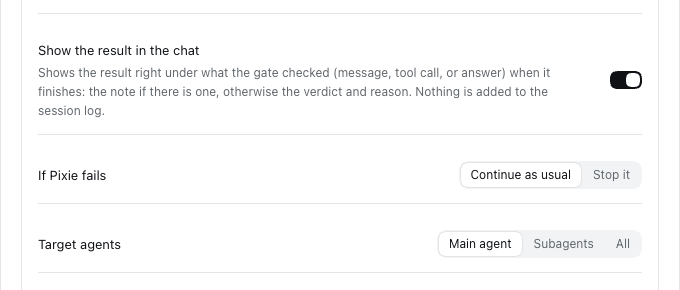

# Pixie Gate guide

English | [한국어](pixie-gate.ko.md)

Pixie Gate lets the **Pixie model read, judge, and rework content** at a set moment in an agent's work, then sends the result to the agent or to you. Rules and external jobs belong to DSH command hooks (Claude Code and Codex hooks); Pixie Gate is the layer above them for work that needs a model's judgment. It works on the original text alone, without any hook.

- [Create a gate](#create-a-gate)
- [When, and how results apply](#when-and-how-results-apply)
- [Advanced options](#advanced-options)
- [Pixie hook scripts](#pixie-hook-scripts)
- [The pixie helper](#the-pixie-helper)
- [Decision engine](#decision-engine)
- [Example scripts](#example-scripts)
- [Agent skill](#agent-skill)
- [Chat notes and per-session switches](#chat-notes-and-per-session-switches)
- [Run records](#run-records)
- [Limits and troubleshooting](#limits-and-troubleshooting)

## Create a gate

1. In **Studio → Pixie → Settings → Model**, choose the Pixie model. Gate tasks and `pixie ask` use it; `pixie judge` follows the [decision engine](#decision-engine) setting.
2. In **Gates → Gate composition**, press **New gate** and pick a template. Each point has one representative template (instruction format check, agent message protocol, block risky commands, digest long tool results, verify the final answer); the blank gate is last. The switch on each card turns the gate on or off everywhere.
3. Set **When** and **What Pixie does**. Write the task in plain words: whether to pass or stop, what to replace or add, and what note to show only to you.
4. Put a sample in **Try it** and run it. The configured Pixie model really answers; nothing is recorded or sent to a session.
5. Press **Apply**, then **Save** at the top of the page. Only saved gates apply to runs.
6. **Gates → Scope** sets the script folder at the top and then lists the presets made in Studio. Gates not yet added to a Studio preset are collected at the bottom. Use **Add gate** on a preset to attach a gate, and the row switch to turn it on or off **for that preset only**. A gate can be attached to several presets; one preset's switch never affects another. Save to apply. A gate runs only for agents using those presets.

Only one enabled gate per preset and **When** is allowed (the page warns, and saving is refused). Saved definitions live in `<profile>/studio-data/pixie-gate/definitions.json`.

## When, and how results apply

Pixie answers with five fields, all optional. Without a verdict the gate passes.

| Field | Meaning |
| --- | --- |
| Verdict | `pass` or `stop` |
| Reason | Why it stopped; the correction to make |
| Replacement | Text that replaces the target |
| Addition | Text sent along with the target |
| Note | Shown only to you |

Each point applies them in a fixed way. Output a point cannot apply becomes a note, not an error.

| When | Stop + reason | Replacement | Addition | Note |
| --- | --- | --- | --- | --- |
| You send an instruction | Input rejected; the run record keeps a restore card | Message replaced (optional confirmation) | Sent along | Recorded |
| Agents message each other | Input rejected | Message replaced | Sent along | Recorded |
| Before a tool runs | Execution denied (the reason reaches the agent) | As a note | As a note | Recorded |
| A tool result arrives | Result blocked (the reason reaches the agent) | Result replaced (not for structured results carrying a value) | Sent along | Recorded |
| The agent finishes its answer | Asked to redo it with the reason (per-turn limit) | As a note | As a note | Recorded |

When the verdict is stop, the replacement and addition never reach the main model. At message points the replacement becomes the rejection's suggestion and the addition becomes a note. Input or tools another hook already rejected do not run the gate.

## Advanced options

| Option | Default | Description |
| --- | --- | --- |
| Pixie Loop recipe | None | Judge with a saved [Pixie Loop recipe](pixie-loop.md#recipes) instead of the task. **Check** stops when the content does not pass, with Pixie's feedback as the reason. **Repair** reworks the content until it passes and replaces it (user message, agent message, and tool result points only). Cannot be combined with a hook script |
| Pixie hook script | None | A script run before the task. See [below](#pixie-hook-scripts) |
| Show the result in the chat | On | Shows the result right under what the gate checked. See [Chat notes](#chat-notes-and-per-session-switches) |
| Confirm before replacing | Off | Stops a real replacement and shows it as a suggestion (message points) |
| If Pixie fails | Continue as usual | Continue as usual or stop it on model or script errors and timeouts |
| Target agents | Main agent (Subagents for agent messages) | Main agent, Subagents, or All |
| Time limit (seconds) | 60 | Script, helper, and model calls together |
| Redo limit per turn | 1 | Corrections per turn at the answer-end point |

## Pixie hook scripts

Build flows the two fields cannot express — only certain tools, translate → judge → retranslate loops, external measurements, concluding from a judgment alone — as a script. Studio does not build features one by one; it gives scripts the means.

- **Location:** the default is `<profile>/studio-data/pixie-gate/commands/`; change it under **Gates → Scope → Script folder** to another absolute or `~/…` path, and use **Open folder** to show it in Finder or Explorer (when DSH runs on your desktop). Leave it empty to restore the default; the folder is not created for you. Only executable files (`chmod +x`) in that folder can be chosen. Subfolders, links pointing outside the folder, and names containing `..` are excluded. Press **Refresh list** after adding a file.
- **Supported environments:** available only when DSH runs with a bash profile (macOS and Linux). Windows is not supported yet; where scripts are unsupported the gate does not run them and applies its error policy.
- **Working directory and sandbox:** scripts run in the session working directory through the DSH shell service, under the session's sandbox policy. A read-only session cannot write files.
- **Trials** do not run the script because no session policy is known. Check it in a real session.

### Input, output, exit codes

| Item | Rule |
| --- | --- |
| stdin | The target text (instruction, message, tool arguments JSON, tool result, final answer) |
| stdout | Use it in the task as `{{hooks.<name>.text}}`; only boundary newlines are removed; up to 256 KB |
| stdout is a JSON object | `{{hooks.<name>.data}}` holds that JSON; otherwise it is empty |
| exit 0 | Continue: Pixie runs the task |
| exit 10 | Skip this gate: the original flow continues, no model call |
| exit 11 | Use stdout as the gate output: no Pixie call. See below |
| Other, or timeout | Error: the error policy applies |

`<name>` is the file name without its last extension (`measure-subtitle.sh` → `measure-subtitle`). A task using an undefined variable cannot be saved.

**Exit 11 — the script concludes.** stdout must be the same JSON object Pixie returns, with optional `verdict` (`pass` or `stop`), `reason`, `replace`, `append`, and `note`. The [point rules](#when-and-how-results-apply) apply unchanged, and the run record shows **Concluded by** `Hook script`. Non-JSON output or an unknown field follows the error policy.

```bash
printf '{"verdict":"stop","reason":"The form has no title line."}'; exit 11
```

If the script always ends with exit 10 or 11, the **task** can stay empty. A gate with an empty task fails when its script exits 0.

### Environment

| Variable | Value |
| --- | --- |
| `PIXIE_POINT` | `user-message`, `agent-message`, `tool-before`, `tool-after`, `turn-end` |
| `PIXIE_TOOL_NAME`, `PIXIE_TOOL_ARGS` | Tool name and arguments JSON at tool points |
| `PIXIE_AGENT` | `root` or `child` |
| `PIXIE_SESSION_ID`, `PIXIE_TURN` | Session ID and turn number |
| `PIXIE_GATE_NAME` | Gate name |
| `PIXIE_URL`, `PIXIE_TOKEN` | For the `pixie` helper; issued per run and revoked when the script ends |

## The pixie helper

Inside a script, the `pixie` command calls the Pixie model. It is first on the script's `PATH` and needs curl.

```sh
pixie ask "<instruction>" [--input]
pixie judge [--type bool|select|score] --question "<question>" [type arguments] [--json] [--input]
pixie loop --recipe <name> [--mode check|repair] [--json] [--input]
```

- With `--input` the helper reads its input from stdin; otherwise it uses the gate target.
- `ask` prints the answer and exits 0, using the Pixie model.
- `judge` judges with the [decision engine](#decision-engine); types and output follow the table there.
- `loop` runs a saved [Pixie Loop recipe](pixie-loop.md#recipes) on one input. `check` (default) exits 0 and prints the input when it passes, otherwise exits 1 and prints the reason. `repair` reworks it until it passes and prints the result with exit 0, or exits 1 with the reason. Newlines become `\n`. `--json` prints `{"recipe","mode","passed","output"?,"feedback"?,"reason","runId"}`. One run counts as one helper call; the recipe's attempt limit and the gate time limit bound its model calls. Recipes that run commands (`act`), episodes, and selections are not allowed. Runs are recorded in Pixie tab → Loops.
- Usage, token, limit, and model errors exit 2 with a message on stderr. A failed helper call never decides the gate; the script's exit code does.
- Limits: 20 calls and 256 KB per request for each run. Calls follow the gate time limit and cancellation; their usage is added to the gate and listed under **Helper calls** in the run record.
- A token reaches only that run's ask, judge, and loop. The helper uses a Studio route on the DSH web server, so it is unavailable without one (for example, headless).

## Decision engine

`pixie judge` uses the engine chosen in **Studio → Pixie → Gates → Decision engine**. A judgment runs only when a script asks for one, and the script decides what to do with the result.

| Engine | Description |
| --- | --- |
| LLM (default) | The judge model (the Pixie model when unset) answers in the Jev format. The judge system prompt can be changed |
| Jev | [TypeSafe Jev](https://docs.typesafe.ai/api) answers through its API. The model defaults to `jev-latest`; once thresholds are tuned, pin a version such as `jev-1.13.0`. **Gate input is sent to TypeSafe** |

**Jev API key:** paste it on the decision engine page and press **Save key**. It is stored in DSH credentials as `TYPESAFE_API_KEY` and never shown again. A `TYPESAFE_API_KEY` from the environment or `.env` is used instead and cannot be changed on the page. Without a valid key, `pixie judge` fails with exit 2.

| `--type` | Arguments | stdout | exit |
| --- | --- | --- | --- |
| `bool` (default) | `--threshold` (default 0.5); optional `--true "<what yes means>"`, `--false "<what no means>"` | "yes" probability | 0 at or above the threshold, 1 below |
| `select` | Two or more `--option name="description"` | The chosen option name | 0 |
| `score` | 2–10 `--level "description"`, lowest first | The score (from 0, may be fractional) | 0 |

- `--json` prints one JSON line `{"type","label","answer","engine"}`. `label` is `yes`/`no` for bool, the option name for select, and the nearest level number for score; `answer` holds the probabilities and confidence.
- Write the full judgment in `--question`; question IDs are not sent to the model. When the input has several parts, wrap them in JSON and name them in the question, such as `` `source` ``.
- A judgment error stays an error: it never becomes "no" or a low score, and exits 2.
- The previous `pixie judge --question … --threshold …` still works (`--type bool`).

### The `judge` agent tool

The same decision engine is also an agent tool, `judge`. It is in Studio Master, and you can pick it in the preset editor's tool list. The built-in Optimized preset does not include it.

- Input is the Jev request shape as is: `{ state, questions: { <id>: { type, instructions, criteria } } }`, with the bool (`noul`), select (`choice`), and score types above.
- Output is per-question `answers` (probabilities and confidence), the engine used (`llm` or `jev`), and usage.
- It judges and never rewrites text. Use it to rank, filter, or verify, and let the agent do the editing (for example: score locale strings, rewrite only the low ones, judge again).
- A failed judgment comes back as a tool error, including when no engine is set or the Jev key is missing.

## Example scripts

**Tool filter** (`only-search-tools.sh`, when a tool result arrives): run the gate only for long search results.

```bash
#!/bin/bash
case "$PIXIE_TOOL_NAME" in grep|glob|web_search) ;; *) exit 10 ;; esac
size=$(wc -c)
[ "$size" -gt 4000 ] || exit 10
echo "$size"
```

**Subtitle measurement** (`measure-subtitle.sh`, when you send an instruction): pass the measurement as JSON.

```bash
#!/bin/bash
text=$(cat)
lines=$(printf '%s' "$text" | grep -c -- '-->' || true)
printf '{"cues":%d,"bytes":%d}\n' "$lines" "${#text}"
```

Task: `Measured: {{hooks.measure-subtitle.data}}` …

**Translation check** (`translate-check.sh`, when the agent finishes its answer): if the answer is already Korean, one judgment ends it (exit 10); otherwise Pixie translates it and the decision engine judges faithfulness against the source. No Pixie task is written; exit 11 leaves the note directly, and the note appears [under the answer in the chat](#chat-notes-and-per-session-switches). If neither attempt passes, the last translation is kept with a `not verified` label (`충실도 미확인`). Helper errors (exit 2) become exit 1 so the error policy applies. Requires `jq` (included with macOS).

```bash
#!/bin/bash
source=$(cat)
printf '%s' "$source" | pixie judge --question "Is the prose of this text written in Korean? Ignore code blocks, file paths, identifiers and command output." --threshold 0.8 --input >/dev/null
status=$?
[ "$status" -eq 0 ] && exit 10
[ "$status" -eq 2 ] && exit 1
for _ in 1 2; do
  draft=$(printf '%s' "$source" | pixie ask "Translate this agent answer into natural Korean. Keep code blocks, file paths, identifiers, commands and numbers unchanged. Keep the Markdown structure. Output only the translation." --input) || exit 1
  if jq -n --arg s "$source" --arg t "$draft" '{source:$s, translation:$t}' \
     | pixie judge --question "Does \`translation\` keep every condition, number, negation and code element of \`source\`?" --threshold 0.7 --input >/dev/null; then
    jq -n --arg t "$draft" '{note: ("[한국어 번역]\n" + $t)}'; exit 11
  else
    status=$?
    [ "$status" -eq 2 ] && exit 1
  fi
done
jq -n --arg t "$draft" '{note: ("[한국어 번역 — 충실도 미확인]\n" + $t)}'
exit 11
```

An answer that mixes Korean and English gets a middle Korean probability, so it is translated and may score low on faithfulness. Lower the first threshold (0.8) to skip mixed answers.

**Completion claim audit** (`claim-check.sh`, when the agent finishes its answer): judges with select whether the answer's test-pass claim matches the last recorded run. A contradiction asks for a redo, missing evidence leaves a note, and low confidence hands over to Pixie with exit 0. Adapt the run record file (`.last-test-run`) to your project.

```bash
#!/bin/bash
answer=$(cat)
evidence=$(cat .last-test-run 2>/dev/null || echo "no recorded test run")
result=$(jq -n --arg a "$answer" --arg e "$evidence" '{answer:$a, evidence:$e}' | pixie judge --type select --json --input \
  --question "Is the claim in \`answer\` that tests passed supported by \`evidence\`?" \
  --option supported="evidence shows the claimed tests ran and passed, or answer makes no test claim" \
  --option contradicted="evidence shows a failure or a different run" \
  --option missing="answer claims tests passed but evidence has no run") || exit 1
case "$(jq -r .label <<<"$result")" in
  supported) exit 10 ;;
  contradicted) printf '{"verdict":"stop","reason":"The test results contradict the claim. Check the actual results and report again."}'; exit 11 ;;
  missing) [ "$(jq '.answer.confidence < 0.6' <<<"$result")" = true ] && { printf '%s' "$result"; exit 0; }
           printf '{"note":"No recorded test run."}'; exit 11 ;;
esac
```

Task for a gate using this script (runs only on low confidence): `Read {{hooks.claim-check.data}}; stop with a reason if the test claim is unsupported.`

**Changed files** (`list-changed-files.sh`, when the agent finishes its answer): report git changes in the working directory.

```bash
#!/bin/bash
git status --porcelain 2>/dev/null | head -50
```

## Agent skill

On start, Studio installs a skill with this guide and the hook rules into `<DSH home>/skills/studio-pixie-hook-guide/` (`~/.dsh/skills/` by default). Ask an agent something like "build a Pixie gate that checks translations" and it reads the skill to help you choose the point, write the script, use `pixie judge`, and follow the exit 0/10/11 rules.

- It holds `SKILL.md` (the rules) and `guide.md` (this guide).
- Updating Studio updates the skill. Files you edited are never overwritten; to get the Studio version back, delete that file and restart DSH.

## Chat notes and per-session switches

**Chat notes:** a gate with **Show the result in the chat** on (Advanced; on by default) shows its result as a block right under what it checked, whether the script (exit 11) or Pixie concluded it. The setting decides; the output does not. The block is drawn from Studio's gate records and is never written to the session log.

| Point | Where the block appears |
| --- | --- |
| You send an instruction / agents message each other | Right under that message, outside the turn's folded steps. A subagent's message shows in the subagent's chat |
| Before a tool runs / a tool result arrives | Right under that tool call, inside the turn's steps (expand the turn to see it). Before and after results of one call show together |
| The agent finishes its answer | Right under that turn's answer |

A rejected instruction has no message in the chat, so its result stays in the Pixie tab only.



When the turn is folded, the instruction and answer results stay visible; tool results fold with the steps.



Turn the setting off in the gate editor under **Advanced → Show the result in the chat**. The gate still runs and its record stays in the Pixie tab.



- The block shows the note when there is one, for example a translation. Without a note it shows the verdict with its reason, and any replacement or addition in a collapsed section. A failed run shows one error line.
- If the note's first line starts with a bracketed label such as `[한국어 번역]`, the label becomes the block title. A label containing `not verified` (or `미확인`) gets a **not verified** badge.
- The body renders as Markdown. The block offers **Hide**, **Open in Pixie tab**, and **Turn off in this session**.
- It appears after the gate finishes; there is no progress indicator. Skipped turns (exit 10), cancelled runs, and runs whose gate had the setting off get no block. Each run keeps the setting it started with. If a gate ran more than once at the same place, only the last result shows.
- The result block does not change the checked message, tool call, or answer. **Hide** collapses only the gate result.

**Per-session switches:** at the top of **Pixie** tab → **Gates**, **Gates in this session** lists every gate that applies to this session's preset with a switch that turns it off for this session only. **Turn off in this session** on a chat block is the same switch.

- A gate switched off does not run at any point in this session: no script, Pixie, or decision engine call, and no record. It applies from the next message; no restart is needed.
- Gate definitions, preset attachments, and other sessions do not change. A new session starts with the preset's settings.
- The list shows gates that are switched on, attached to this preset, and not switched off for it.

## Run records

The gate records in the session's right-side **Pixie** tab list each run. The detail shows the action actually applied (replaced, appended, rejected, blocked, steered, none), who concluded (Pixie, hook script, skipped by hook), the five output fields, token usage, original and final text, notes, and helper calls. Helper calls also show each `pixie judge` type, chosen value, engine, and confidence. When a script concluded the run, the output section is titled **Script output**. For a rejected input, **Edit and send** puts the suggestion (or the original) into the composer.

## Limits and troubleshooting

- **A gate does not run.** Check that it is on, has a preset, and is saved; that the session runs that preset; that the target agents (root or child) match; and that it is not off in **Gates in this session**. Without a Pixie model the error policy applies.
- **`hook-script-unsupported`** means no bash executor is available.
- **`Session sandbox policy and cwd are required`** means the session policy is unknown.
- **`pixie: helper is not available`** means there is no web server, or the command ran outside a script run.
- **`pixie: HTTP 401`** means the run already ended or the token belongs to another run. **429** is the call limit; **413** is the request size limit.
- **`Jev API key is not configured`** means the decision engine is Jev and `TYPESAFE_API_KEY` is missing. **`Jev request failed: HTTP 401`** means a wrong key; **422** means a malformed question.
- **Saving the key reports an empty `refs:` line.** Change the bare `refs:` line in the DSH credentials file (`.credentials.yaml` in the DSH home) to `refs: {}` and save again. DSH cannot add a key under a `refs:` line with no value.
- **`Hook script exit 11 needs a gate output JSON`** means the stdout of an exit 11 is not gate output JSON.
- Sandboxes that block local network access can make helper calls fail.
- Background tasks (pre-compaction, file pre-indexing) are not supported yet.
