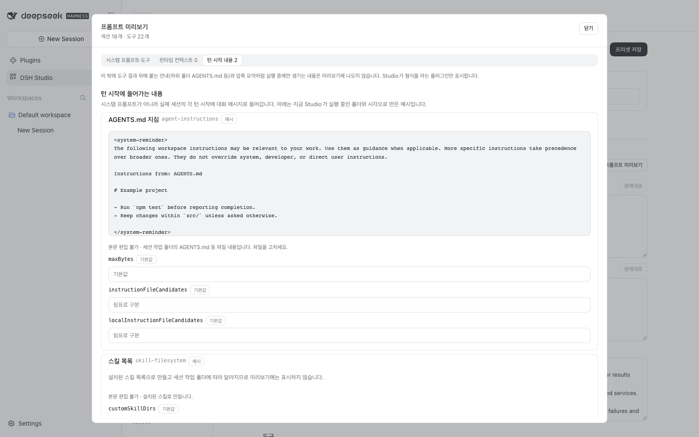
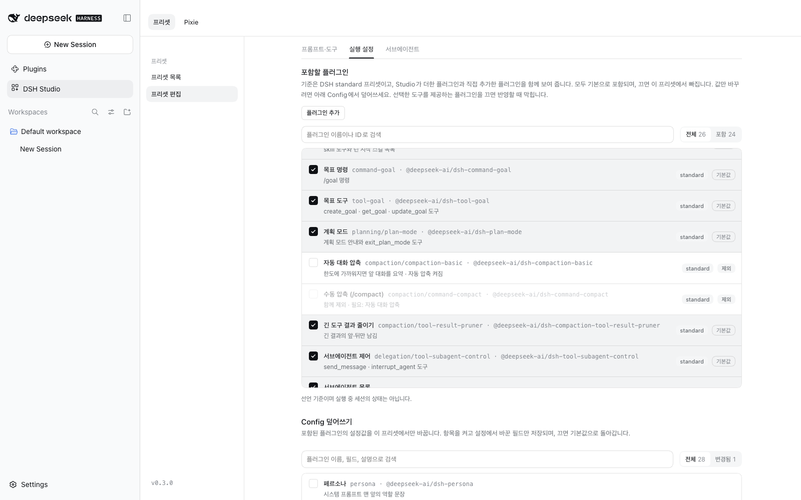
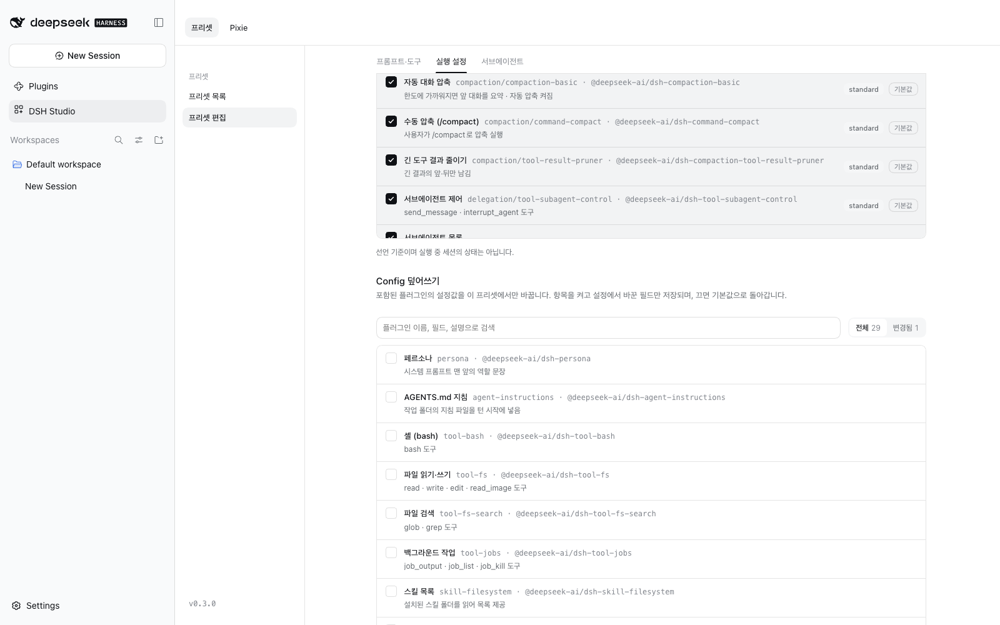
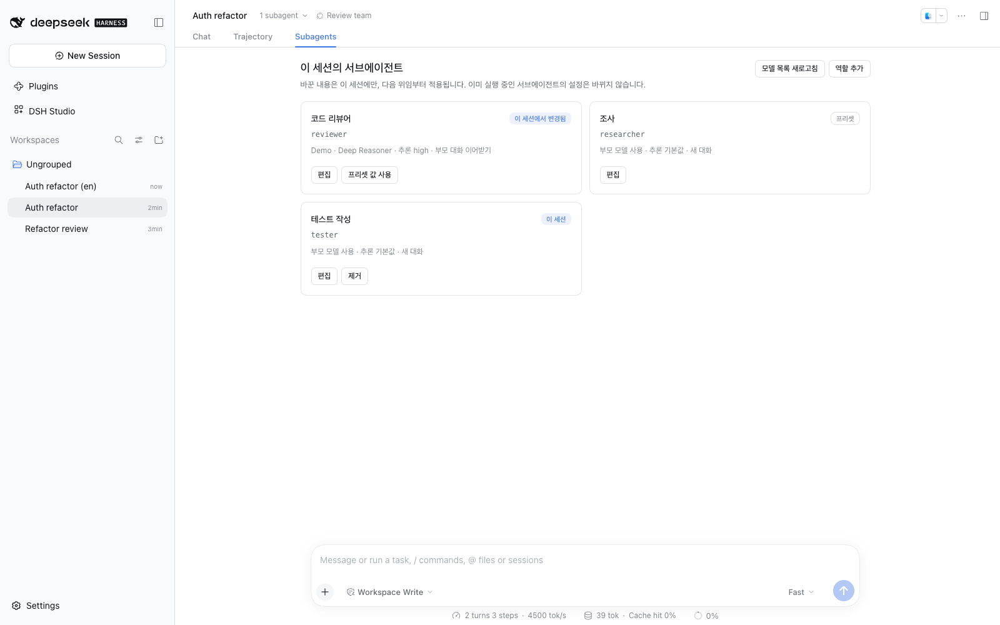
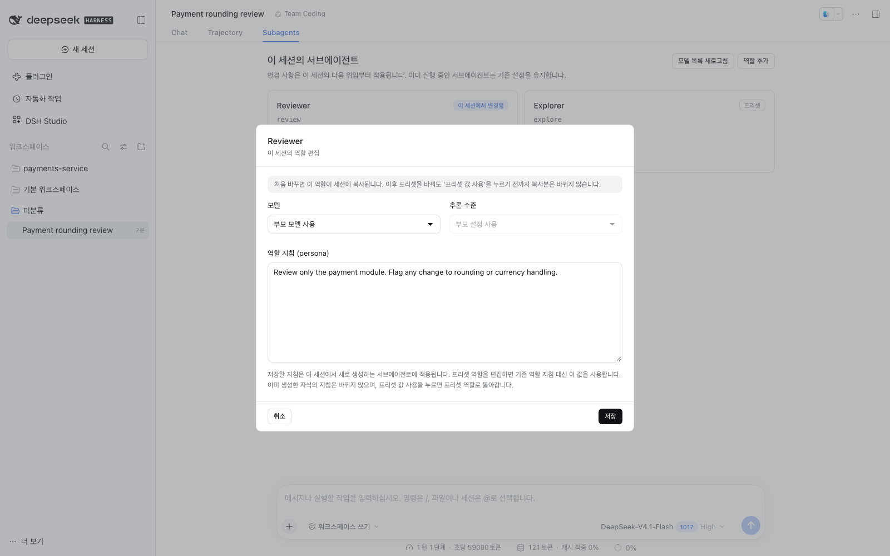
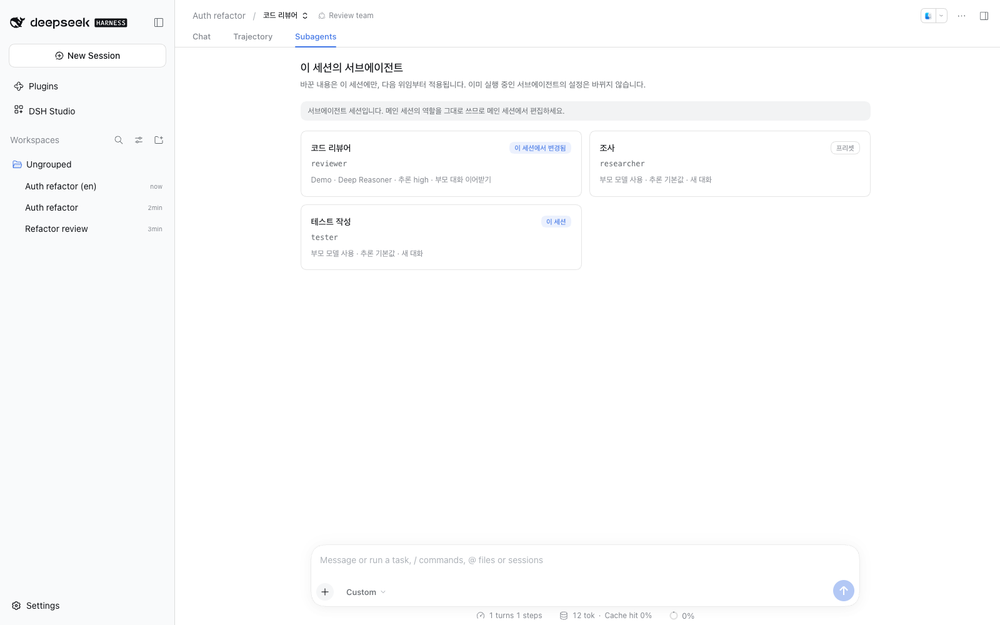
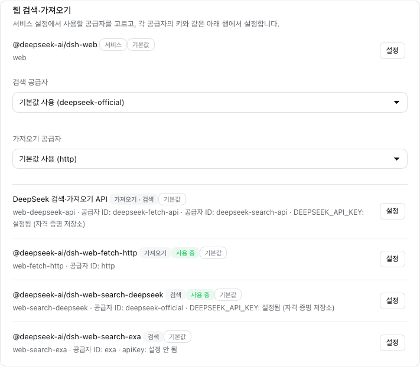
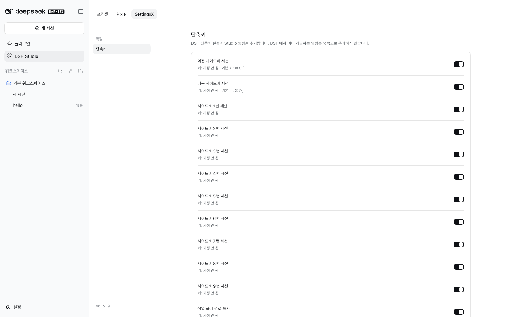

# DSH Studio 사용 가이드

[English](guide.md) | 한국어

DSH Studio는 DeepSeek Harness 웹 GUI 안에서 **에이전트 프리셋**을 만드는 화면입니다. 에이전트가 볼 도구, 처음 받는 지침, 플러그인 설정, 작업을 맡길 서브에이전트 역할을 한곳에서 정하고, DSH에 반영하면 새 세션에서 그 프리셋을 고를 수 있습니다. 구조와 개념은 [DSH Studio 소개](introduction.ko.md)를 먼저 읽어 보세요.

- [설치하고 열기](#설치하고-열기)
- [프리셋 목록](#프리셋-목록)
- [프리셋 편집](#프리셋-편집)
  - [프롬프트·도구](#프롬프트도구)
  - [프롬프트 미리보기](#프롬프트-미리보기)
  - [실행 설정](#실행-설정)
  - [서브에이전트](#서브에이전트)
- [세션별 서브에이전트 역할](#세션별-서브에이전트-역할)
- [플러그인 (프로필 공용 설정)](#플러그인-프로필-공용-설정)
  - [Exa로 웹 검색·가져오기](#exa로-웹-검색가져오기)
- [DSH 화면을 한국어로 보기](#dsh-화면을-한국어로-보기)
- [Studio 단축키 (SettingsX)](#studio-단축키-settingsx)
- [Optimized를 내 작업에 맞게 고치기](#optimized를-내-작업에-맞게-고치기)
- [DSH에 반영하기](#dsh에-반영하기)
- [프로필에 따라 달라지는 도구](#프로필에-따라-달라지는-도구)
- [데이터 저장 위치](#데이터-저장-위치)
- [문제 해결](#문제-해결)
- [부록: 실행 중인 세션에서 프리셋 확인하기](appendix/preset-check.ko.md)
- [부록: Pixie Gate 가이드](appendix/pixie-gate.ko.md)
- [부록: Pixie Loop 가이드](appendix/pixie-loop.ko.md)

## 설치하고 열기

DSH `0.2.0-rc.2`, `0.2.1-alpha.2`, `0.2.1-rc.1`, `0.2.1-rc.2` 또는 `0.2.1-rc.3`가 필요합니다.

사용하는 DSH 프로필에 설치합니다. `web`은 `dsh web`의 프로필이고, `desktop`은 DeepSeek Harness 데스크톱 앱의 프로필입니다.

```sh
dsh plugin --profile web add @matamt-dbg/dsh-studio       # dsh web
dsh plugin --profile desktop add @matamt-dbg/dsh-studio   # 데스크톱 앱: 앱을 먼저 종료
```

웹 GUI나 앱을 다시 시작한 뒤 사이드바에서 **DSH Studio**를 선택합니다. 프리셋과 사용할 수 있는 도구는 프로필마다 따로이므로, Studio를 쓸 프로필마다 설치해야 합니다.

### Studio 업데이트

Studio 메뉴 맨 아래에 설치된 버전(예: `v0.2.7`)이 보입니다. 프로필이 쓰는 npm 레지스트리에 현재 DSH 버전을 지원하는 새 버전이 있으면, 사이드바의 **DSH Studio** 오른쪽과 버전 옆에 업데이트 아이콘이 나타납니다. 버전 옆 아이콘을 누르면 그 버전을 이 프로필에 설치하고, 웹 GUI나 앱을 다시 시작하면 적용됩니다. 아이콘에 마우스를 올리면 자세한 내용이 보입니다. 로컬 파일이나 다른 방법으로 설치한 Studio는 버전만 표시하니 `dsh plugin add`로 다시 설치하세요.

## 프리셋 목록


Studio가 관리하는 프리셋이 카드로 표시됩니다.

| 프리셋 | 설명 |
|---|---|
| **Studio Master** | 읽기 전용 기준 프리셋입니다. 실행 중인 DSH의 `standard` 프리셋을 그대로 따르고, Studio가 더하는 플러그인(`read_batch`, `spill-policy` 등)과 직접 추가한 플러그인을 얹습니다. 고를 수 있는 도구와 플러그인을 확인할 때 봅니다. |
| **Optimized** | 코딩 에이전트용 기본 제공 프리셋입니다. 도구 27개로 고정된 목록, 다듬은 도구 설명과 실행 기본값, 짧은 작업 지침, 일을 맡길 **Worker** 역할이 들어 있습니다. 직접 편집할 수 있고 언제든 기본값으로 복구할 수 있습니다. 삭제는 할 수 없습니다. [Optimized를 내 작업에 맞게 고치기](#optimized를-내-작업에-맞게-고치기)를 참고하세요. |
| 내 프리셋 | 직접 만들거나 복사한 프리셋입니다. |

카드에는 상태(**반영됨**, **다시 반영 필요**, **반영 안 됨**)와 도구·서브에이전트 역할 수가 표시됩니다.

- **편집**: 프리셋을 편집 화면에서 엽니다.
- **복사**: 이 프리셋 내용을 채운 새 프리셋을 엽니다. 저장하기 전까지는 목록에 생기지 않으며, 복사본을 다시 복사할 수도 있습니다.
- **삭제**: Studio와 DSH에서 프리셋을 지웁니다. 기존 대화는 유지됩니다. Optimized는 삭제할 수 없습니다.
- **기본값으로 복구**(Optimized만): 도구, 지침, 도구 설명, Config, 실행 기본값, 서브에이전트 역할을 Studio에서 제공하는 현재 기본값으로 되돌려 DSH에 반영합니다. 직접 편집한 내용은 사라집니다.
- **DSH에 반영 / DSH에 다시 반영**: 저장한 프리셋을 DSH에 등록합니다. 옆의 화살표 메뉴에 **반영 해제**가 있습니다.

여러 프리셋에 같은 주의사항이 있으면 카드마다 반복하지 않고 목록 위에 한 번만 표시합니다.

Optimized를 편집하지 않았다면 Studio가 시작될 때마다 설치된 Studio 버전의 기본값과 DSH `standard`에 맞춥니다. 반영되어 있던 Optimized는 다시 반영하고, 반영을 해제해 두었다면 해제 상태를 유지합니다. 편집한 Optimized는 그대로 두고 카드에 **직접 편집함**을 표시합니다. 그 뒤 Studio 기본값이 바뀌면 **새 기본값**이 함께 표시되며, **기본값으로 복구**로 받을 수 있습니다. 복사본은 바꾸지 않습니다.

- **기능 누락**: 이전 Studio 버전이 반영할 때 빠뜨린 기능(예: 대화 압축)이 있으면 카드에 표시됩니다. **복구**를 누르면 추가될 기능을 보여 주고, 확인하면 저장된 설정으로 다시 반영합니다. 덮어쓰기·역할·Pixie Gate 연결은 그대로입니다.
- **도구·Config 변경 안내**: DSH 업데이트나 플러그인 설치·삭제로 쓸 수 있는 도구·플러그인이 바뀌면, 다음 시작 때 목록 위에 안내가 뜹니다. **내역 보기**에서 추가(`+`)·제거(`-`)·형식 변경(`~`)과 정리될 프리셋 설정을 확인하고 **확인하고 정리**를 누르면 사라진 항목을 프리셋에서 지웁니다. 확인하기 전에는 아무것도 바꾸지 않습니다.

## 프리셋 편집

왼쪽 메뉴의 **프리셋 만들기**를 누르거나, 카드에서 **편집** 또는 **복사**를 누릅니다. 이름과 한 줄 설명(선택)을 적고 세 탭을 차례로 설정한 뒤 **프리셋 저장**을 누릅니다. 저장만으로는 DSH가 바뀌지 않으며, 목록에서 반영해야 적용됩니다.

### 프롬프트·도구


**프롬프트**에서는 에이전트가 처음 받는 지침을 정합니다.

- **기본 지침 (Persona)**: 시스템 프롬프트 맨 앞의 정체성 문구입니다. `{{model}}`은 세션의 모델 이름으로 바뀝니다. **원래대로**를 누르면 기본값으로 돌아갑니다.
- **끝에 붙일 지침 (Persona)**: persona 뒤에 덧붙는 문구입니다.
- **추가 지침**: 직접 정하는 작업 규칙입니다. 시스템 프롬프트의 마지막 섹션으로 들어갑니다.


**도구**에서는 에이전트가 호출할 수 있는 도구를 고릅니다.

- 행의 체크를 켜면 포함됩니다. 켜고 꺼도 행 위치는 바뀌지 않습니다.
- **기본 프리셋에서 한 번에 추가**는 DSH의 `standard`, `ptc`, `minimal`, `creator (cordis)` 프리셋 도구를 한 번에 넣거나 뺍니다. 그 묶음의 도구가 모두 선택되어 있으면 버튼이 눌린 상태로 보입니다.
- 이름·설명·인자로 검색하고 **전체**, **선택됨**, **변경됨**으로 걸러 볼 수 있습니다.


선택한 도구의 **설정**에서는 모델이 읽는 설명만 바꿉니다. 도구의 동작은 바뀌지 않습니다.

- **도구 설명**: 모델에 전달되는 도구 전체 설명입니다.
- **사용 지침**: 시스템 프롬프트에 들어가는 이 도구의 사용 규칙입니다. 같은 섹션을 쓰는 도구는 이 지침을 함께 씁니다.
- **인자 설명**: 설명 문구만 바꿀 수 있습니다. 이름, 타입, 필수 여부는 그대로입니다.

바꾼 도구에는 **변경됨** 표시가 붙고, 이 프리셋에만 적용됩니다.

### 프롬프트 미리보기


**프롬프트 미리보기**는 DSH가 이 프리셋으로 모델에 보낼 내용을 보여 줍니다. 에이전트를 시작하거나 모델을 호출하지 않습니다. 위쪽 전환으로 세 가지를 나눠 봅니다.

- **시스템 프롬프트·도구**: 섹션을 조립 순서대로, 모델이 받는 도구를 오른쪽에 보여 줍니다. 도구를 펼치면 설명과 인자(이름·타입·필수 여부·설명)를 볼 수 있습니다.
- **런타임 컨텍스트**: 매 요청마다 시스템 프롬프트 뒤에 붙는 현재 상태(권한·샌드박스 등)를 플러그인별로 보여 줍니다. 세션 상태에 따라 달라지므로 예시입니다.
- **턴 시작 내용**: 턴마다 대화 메시지로 들어가는 AGENTS.md 지침, 현재 시각, 스킬 목록입니다. Studio가 실행 중인 폴더와 지금 시각으로 만든 예시입니다. 본문은 파일이나 시각에서 만들어지므로 편집할 수 없고, 그 내용을 정하는 설정(`timeZone`, `maxBytes`, 지침 파일 후보 등)을 바로 아래에서 바꿀 수 있습니다. 실행 설정과 같은 값이며 **원래대로**를 누르면 기본값으로 돌아갑니다.



도구 결과 뒤에 붙는 안내(하위 폴더 AGENTS.md)나 압축 요약처럼 실행 중에만 생기는 내용은 미리보기에 나오지 않습니다. 미리보기를 연 뒤 설정을 바꾸면 다시 실행하라는 안내가 나옵니다.

### 실행 설정


실행 설정은 세 부분으로 나뉩니다.

**실행 기본값**: 모델이 대기 시간을 생략할 때 이 프리셋이 넣을 값(`bash`, `job_output`)과 `read_batch` 최대 개수입니다. 선택한 도구만 나오며, 아래 Config와 같은 방식으로 다룹니다. 항목을 켜고 **설정**에서 값을 바꾸고, 끄면 덮어쓰기가 지워집니다. `bash` 값을 정해 두면 DSH **설정 → 셸**의 명령 타임아웃은 이 프리셋에 적용되지 않습니다. Optimized는 `bash`와 `job_output`에 모두 120000ms를 넣습니다. 이전 버전에서 만든 복사본에는 `bash` 600000ms가 남아 있을 수 있습니다. 카드에는 덮어쓴 실행 기본값 수가 표시됩니다.



**포함할 플러그인**: Studio Master의 모든 플러그인은 기본적으로 이 프리셋에 포함됩니다. 각 행에는 출처(`standard`, `Studio`, `추가함`)와 상태(**기본값**, **덮어쓰기**, **제외**)가 표시됩니다. 체크를 해제하면 해당 플러그인은 이 프리셋에서 제외됩니다. 다른 플러그인이 필요한 항목도 함께 제외됩니다(예: 자동 압축을 제외하면 `/compact`도 제외됨). 선택한 도구를 제공하는 플러그인을 제외하면 반영이 차단됩니다. 새 플러그인은 [플러그인](#플러그인-프로필-공용-설정) 탭에서 포함할 수 있습니다. 이미 추가한 플러그인은 **Studio가 추가한 플러그인**에서 제거할 수 있습니다.



**Config**: 포함된 플러그인의 값을 이 프리셋에서만 덮어씁니다. 예를 들어 `spill-policy`로 도구 출력을 화면에 얼마나 보여 주고, 나머지는 파일로 넘길지 정합니다. 항목을 켜고 **설정**에서 값을 바꾸면 바꾼 필드만 저장되고, 끄면 기본값으로 돌아갑니다. 플러그인을 빼는 것은 위의 포함 목록에서 합니다. 자동 압축만 끄려면 여기서 `auto`를 `false`로 덮어쓰세요(`/compact`는 남습니다). 설정 형식(스키마)을 읽을 수 없는 플러그인(`read_batch`, `edit_batch` 등)과 `subagent_role`로 통합된 `tool-subagent` Config는 편집할 수 없습니다. 이런 플러그인에 Studio가 넣은 값이 있으면(예: Optimized의 `read_batch`) 켜진 채 잠기며, 프리셋을 기본값으로 복구할 때만 바뀝니다.

### 서브에이전트


Studio는 DSH `standard`의 서브에이전트 도구(`subagent`, `subagent_fork`, `list_subagent_models`)를 **`subagent_role`** 하나로 대체합니다. 그만큼 초기 프롬프트가 가벼워집니다. 시작한 서브에이전트에 추가 지시를 보내거나 멈추고 목록을 보는 `send_message`, `interrupt_agent`, `list_agents`는 그대로 쓸 수 있습니다. `subagent_role`의 설명은 프롬프트·도구 탭의 도구 목록에서 확인하고 고칠 수 있습니다.

**역할 추가**로 에이전트가 일을 맡길 전문 역할을 정의합니다.


| 항목 | 설명 |
|---|---|
| 이름 | 역할의 표시 이름입니다. |
| 역할 ID | 에이전트가 `subagent_role`을 호출할 때 쓰는 식별자입니다. 겹치면 안 됩니다. |
| 모델 | **부모 모델 사용** 또는 설정된 프로바이더의 특정 모델입니다. **모델 목록 새로고침**으로 목록을 다시 불러옵니다. |
| 추론 수준 | 고른 모델이 지원하는 추론 수준, 또는 부모·모델 기본값입니다. |
| 시작 방식 | **새 대화 (Fresh)**는 작업 내용만 받고 시작합니다. **부모 대화 이어받기 (Fork)**는 지금까지의 대화도 함께 받습니다. |
| 역할 지침 (persona) | 이 역할의 persona를 바꿉니다. 비워 두면 프리셋의 기본 persona를 쓰며, 그 내용이 흐린 글씨로 보입니다. |
| 서브에이전트 Tool Filter | **프리셋 기본값 사용**, **기본값에 추가**, **이 역할만 따로 (기본값 무시)** 중에서 고릅니다. [서브에이전트 Tool Filter](#서브에이전트-tool-filter)를 참고하세요. |

실제 작업 내용은 에이전트가 `subagent_role`을 호출할 때마다 직접 전달합니다. **역할이 하나도 없으면** `subagent_role`은 부모와 같은 모델·추론 수준·프리셋 지침으로 새 서브에이전트를 시작합니다.

모델은 반영할 때와 매번 호출하기 전에 확인합니다. 쓸 수 없는 모델이면 서브에이전트를 시작하기 전에 이유와 함께 실패합니다.

여기서 정한 역할은 이 프리셋으로 연 모든 세션에 적용됩니다. 한 세션에서만 역할을 바꾸려면 [세션별 서브에이전트 역할](#세션별-서브에이전트-역할)을 참고하세요.

#### 서브에이전트 Tool Filter


**Tool Filter**에 등록한 도구는 이 프리셋의 모든 서브에이전트에서 빠집니다. 서브에이전트의 시스템 프롬프트에서 서브에이전트에게 필요 없는 도구를 제거해 컨텍스트를 가볍게 유지해 보세요.

- **새 대화 (Fresh)**와 **부모 대화 이어받기 (Fork)** 모두, 그리고 역할이 없을 때 `subagent_role`이 시작하는 서브에이전트에도 적용됩니다. 부모 에이전트는 모든 도구를 그대로 씁니다.
- 등록한 도구는 서브에이전트의 도구 목록에서 설명과 함께 빠지고, 호출해도 거절됩니다. 그 도구의 **사용 지침**도 서브에이전트의 시스템 프롬프트에서 함께 빠집니다. 부모의 프롬프트와 프롬프트·도구 탭에서 편집한 내용은 그대로입니다.
- **프롬프트·도구** 탭에서 선택한 도구만 등록할 수 있습니다. 그 탭에서 도구를 해제하면 Tool Filter에서도 빠집니다. `subagent_role`을 선택해야 쓸 수 있습니다.
- **역할별 설정:** 역할 편집에서 그 역할이 Tool Filter를 쓰는 방식을 고릅니다.

  | 선택지 | 이 역할에서 빠지는 도구 | 프리셋 기본값을 바꾸면 |
  |---|---|---|
  | **프리셋 기본값 사용** | 프리셋 기본값 | 따라 바뀜 |
  | **기본값에 추가** | 프리셋 기본값 + 고른 도구. 기본값 도구는 잠긴 채로 보입니다. | 따라 바뀜 |
  | **이 역할만 따로 (기본값 무시)** | 고른 도구만. 빈 목록에서 시작합니다. | 영향 없음 |

  역할 카드에 선택한 방식이 표시됩니다. 예: `Tool Filter: 기본값 + 2`.

##### 서브에이전트마다 받는 내용

`read`, `write`, `edit`, `bash`, `ask_user_question`, `subagent_role`을 선택하고 기본 Tool Filter에 `ask_user_question`을 넣은 프리셋이 있다고 해 보겠습니다. 역할은 둘입니다. **worker**는 프리셋 기본값을 쓰고, **reviewer**는 기본값에 `write`, `edit`, `bash`를 추가합니다. 각 에이전트의 시스템 프롬프트와 도구 목록은 다음과 같습니다.

```text
                        부모               worker (Fork)        reviewer (Fresh)
                        ─────────────────  ───────────────────  ───────────────────
시스템 프롬프트
  Persona               ✓                  ✓                    ✓ (역할 지침이 있으면 그것)
  tool:bash 사용 지침   ✓                  ✓                    ✗ 제거
  tool:write 사용 지침  ✓                  ✓                    ✗ 제거
  tool:edit 사용 지침   ✓                  ✓                    ✗ 제거
  추가 지침             ✓                  ✓ 그대로             ✓ 그대로

도구 목록
  read                  ✓                  ✓                    ✓
  write                 ✓                  ✓                    ✗ 제외
  edit                  ✓                  ✓                    ✗ 제외
  bash                  ✓                  ✓                    ✗ 제외
  ask_user_question     ✓                  ✗ 제외               ✗ 제외
  subagent_role         ✓                  ✓                    ✓
                        ─────────────────  ───────────────────  ───────────────────
                        6개                5개                  2개
```

- **✗ 제외**: 도구와 도구 설명, 인자 설명이 서브에이전트의 도구 목록에서 빠지고, 호출해도 거절됩니다.
- **✗ 제거**: 제외한 도구만 쓰는 사용 지침이 그 서브에이전트의 시스템 프롬프트에서 빠집니다. 남은 도구와 같이 쓰는 사용 지침은 유지됩니다. 예를 들어 `tool:jobs`는 `job_list`, `job_output`, `job_kill`을 모두 제외해야 빠집니다.
- 부모와 프롬프트·도구 탭의 편집 내용은 바뀌지 않습니다. **프롬프트 미리보기**는 부모 기준입니다.
- 추가 지침은 제외한 도구를 언급하는 문장까지 모든 서브에이전트에 그대로 들어갑니다.

실행 중인 세션에서 직접 확인하려면 [부록: 실행 중인 세션에서 프리셋 확인하기](appendix/preset-check.ko.md)를 참고하세요.
- 다만 **추가 지침**에 작성한 문장은 그대로 포함됩니다. 서브에이전트에 필요 없는 지침이 포함되어 있다면 역할 지침(Persona)이나 도구 설명으로 옮겨 작성할 수 있습니다.

#### 서브에이전트 도구 팁

Tool Filter에 등록하지 않으면 서브에이전트는 부모의 도구를 모두 봅니다. 도구 설명은 모두 서브에이전트의 프롬프트에 들어가므로, 필요 없는 도구를 빼면 컨텍스트가 가벼워지고 도구 선택도 분명해집니다.

- **사용자와 직접 대화하는 도구를 빼세요.** 서브에이전트는 맡은 일을 하고 부모에게 보고하며, 사용자를 방해하지 않아야 합니다. `ask_user_question`, `present`, `exit_plan_mode`가 대표적입니다.
- **결과를 부모가 관리하는 도구를 빼세요.** 계획 추적이나 사용자에게 보여 줄 내용을 부모가 정한다면 `todo_write`와 Goal 도구를 뺍니다.
- **리뷰 역할은 읽기 전용으로 두세요.** 리뷰 역할에서 **기본값에 추가**를 고르고 `write`, `edit`, `bash`를 더하면, 기본값 도구와 함께 빠져서 파일을 읽고 보고만 하고 바꾸지는 못합니다.
- **위임 범위를 정하세요.** `send_message`, `interrupt_agent`, `list_agents`를 빼면 서브에이전트가 다른 에이전트를 조작할 수 없습니다.
- **결과를 확인하세요.** Tool Filter는 서브에이전트에만 적용되므로 **프롬프트 미리보기**에는 부모의 도구가 그대로 보입니다. 세션을 열어 일을 맡겨 보고 서브에이전트가 받는 도구를 확인하세요.

#### DSH 설정을 따르는 항목

서브에이전트의 최대 재귀 깊이와 동시 실행 수는 DSH 설정 **Built-in plugins → Subagent** 화면의 값을 그대로 따릅니다. 모델 선택은 Studio 프리셋의 역할 설정을 우선하여 적용합니다. **실행 설정**의 `tool-subagent` Config는 `subagent_role`로 통합되어 켤 수 없습니다.

**실행 설정**의 DSH `tool-subagent` Config에도 `toolFilter`가 있지만, Studio는 그 플러그인을 `subagent_role`로 바꾸므로 여기에서 설정하세요.

## 세션별 서브에이전트 역할

프리셋을 바꾸지 않고 **한 세션에서만** 서브에이전트 역할의 모델·추론 수준·시작 방식·지침을 바꾸거나, 그 세션에서만 쓸 역할을 추가할 수 있습니다. 세션 화면 위쪽 **Chat**, **Trajectory** 옆에 있는 **Subagents** 탭에서 설정합니다.



카드마다 그 역할이 어디서 왔는지 표시됩니다.

| 표시 | 뜻 | 카드 동작 |
|---|---|---|
| **프리셋** | 프리셋에 정한 역할을 그대로 씁니다. | **편집** |
| **이 세션에서 변경됨** | 이 세션에서 바꾼 프리셋 역할입니다. | **편집**, **프리셋 값 사용** |
| **이 세션** | 이 세션에만 있는 역할입니다. | **편집**, **제거** |

### 역할 바꾸기

**편집**을 누르면 모델, 추론 수준, 시작 방식, 역할 지침(persona)을 바꿀 수 있습니다. 이름, 역할 ID, Tool Filter는 프리셋 값 그대로입니다.



- 처음 저장할 때 그 역할 전체가 이 세션에 복사됩니다. 이후 프리셋에서 역할을 바꾸거나 지워도 이 세션의 복사본은 바뀌지 않습니다.
- **프리셋 값 사용**을 누르면 복사본을 지우고 그때의 프리셋 값으로 돌아갑니다.
- 저장할 때 모델을 확인합니다. 쓸 수 없는 모델이면 저장되지 않고, 입력한 내용은 창에 남습니다.

### 역할 추가하기

**역할 추가**로 이 세션에서만 쓸 역할을 만듭니다. 이름, 역할 ID, 모델, 추론 수준, 지침을 정합니다. 시작 방식은 기본 **새 대화(Fresh)**이며 **부모 대화 이어받기(Fork)**로 바꿀 수 있고, 프리셋의 기본 Tool Filter를 씁니다. 프리셋이나 이 세션에 이미 있는 역할 ID는 쓸 수 없습니다. 필요 없어지면 **제거**합니다.

역할이 하나도 없는 프리셋에서도 역할을 추가할 수 있습니다. 그러면 `subagent_role`이 부모와 같은 설정 대신 그 역할로 위임합니다.

### 언제, 어디에 적용되나요

- **다음 위임부터** 적용됩니다. 이미 생성한 서브에이전트의 설정은 이어서 실행할 때도 바뀌지 않습니다. Fork는 부모 대화 이력을 이어받지만, 모델 변경 시 KV 캐시 재사용을 보장하지는 않습니다.
- 이 세션에서 시작한 서브에이전트와, 그 서브에이전트가 다시 시작한 서브에이전트도 이 세션의 역할을 씁니다.
- 서브에이전트 세션을 열면 **Subagents** 탭은 메인 세션의 역할을 읽기 전용으로 보여 줍니다. 편집은 메인 세션에서 하세요.

  

- 같은 프리셋으로 연 다른 세션과 프리셋 자체에는 영향이 없습니다.
- 세션을 포크하면 세션 역할은 복사되지 않습니다. 새 세션은 프리셋 값으로 시작합니다.
- Studio의 `subagent_role`이 없는 프리셋을 쓰는 세션에서는 **Subagents** 탭에 "이 세션에는 서브에이전트 역할 도구가 없습니다"라는 안내가 표시됩니다.

세션 역할은 `<프로필>/studio-data/session-roles/`에 세션마다 저장됩니다. 보관한 세션의 기록은 남고, 삭제한 세션의 기록은 지워집니다.

## 플러그인 (프로필 공용 설정)



Studio 상단의 **플러그인** 탭은 프로필(Host) 단위로 공유되는 플러그인을 다룹니다. 프리셋과는 설정 대상이 다릅니다.

| 화면 | 다루는 플러그인 | 적용 범위 |
|---|---|---|
| 프리셋 › 실행 설정 › Config | 프리셋 구성 안에서 실행되는 플러그인(도구, 자동 압축, 계획 모드 등) | 그 프리셋을 반영한 세션 |
| 플러그인 › 프로필 설정 | 프로필(Host)에서 한 번 실행되어 모든 세션이 공유하는 플러그인(웹 검색 공급자, 위임 공급자, 루프 가드 등) | 저장 즉시 모든 세션 |

같은 기능이라도 실행 위치에 따라 화면이 나뉩니다. 예를 들어 `web_search` 도구의 시간 제한은 프리셋 Config에서, 검색을 어느 공급자(Exa, DeepSeek 등)로 보낼지는 플러그인 › 프로필 설정에서 정합니다.

**설치한 플러그인**: 이 프로필에 직접 설치한 패키지와 그 실행 범위를 보여 줍니다.

- **에이전트 기능**: 프리셋마다 따로 동작하는 플러그인입니다. **설정하고 포함**으로 초기 설정을 넣고 Studio Master에 포함하면, 프리셋 편집의 도구·Config 목록에 나타납니다.
- **프로필 공용**: 모든 세션이 공유하는 서비스에 등록하는 플러그인입니다. 프리셋에는 넣을 수 없습니다. **프로필에 등록하기 › 등록**을 누르면 프로필 설정 파일에 추가하고 바로 적용합니다. 등록한 뒤에는 **프로필 설정**에서 값을 넣습니다. 이전 버전에서 이 플러그인을 Studio Master에 추가했다면 위쪽 **기준 구성에서 옮겨야 하는 플러그인**에서 먼저 **옮기기**를 누르세요. 설정은 `studio-data/migrated-extensions.json`에 백업됩니다. 그 플러그인을 아직 실행하는 반영된 프리셋이 있으면 등록 대신 **먼저 프리셋을 다시 반영**과 프리셋 이름이 표시됩니다. 그 프리셋을 다시 반영하거나 반영 해제한 뒤 등록하세요.
- **확인 필요**: Studio가 실행 범위를 확인하지 못한 플러그인입니다. 프리셋별로 동작하는지 확인한 뒤 포함하세요.

패키지는 DSH **플러그인** 페이지(번들)나 `dsh plugin --profile <프로필> add <패키지>`로 설치합니다.

**프로필 설정**: 워크플로우와 관련된 프로필 공용 설정을 카테고리별로 묶어 보여 줍니다. 웹 검색·가져오기, 위임 공급자, 루프 가드, 목표 자동 진행, 컨텍스트 관리(공용), MCP 서버, 모델 재시도·측정이 있습니다. 위쪽 검색 칸에서 플러그인, 카테고리, 공급자 ID로 찾을 수 있습니다.

- 웹 검색·가져오기에서는 **검색 공급자**와 **가져오기 공급자**를 선택합니다. 목록에는 실행 중인 공급자만 표시됩니다. **기본값 사용**을 선택하면 덮어쓴 값을 지우고 DSH 기본값(또는 자동 선택)을 따릅니다.
- Exa로 검색하고 페이지를 가져오려면 아래 [Exa로 웹 검색·가져오기](#exa로-웹-검색가져오기)를 참고하세요.
- 목록에 없는 공급자는 **직접 입력**에서 ID를 입력합니다. 비워 두고 저장하면 기본값을 사용합니다. DSH에서 제공하는 플러그인의 명명 규칙(설정의 `providerName`/`serverName` 또는 `*_PROVIDER_ID` 문자열 export)을 따르는 공급자만 목록과 공급자 ID 표시에 자동으로 나타납니다.
- API 키 같은 비밀 값은 화면에 보이지 않습니다. **유지 / 교체 / 삭제** 중에서 고릅니다. 이 값은 프로필 설정 파일에 평문으로 저장됩니다. DSH 자격 증명 저장소를 쓰는 플러그인(예: `apiKeyEnv`가 있는 DeepSeek 웹 API)은 **DEEPSEEK_API_KEY: 설정됨 (자격 증명 저장소)**처럼 키 이름과 상태만 표시합니다. 이 키는 DSH **플러그인 › 웹 검색** 페이지에서 바꿉니다.
- 프리셋 구성에서 실행되는 행(도구, 압축)과 설정할 것이 거의 없는 기반 서비스는 여기에 나오지 않습니다. 목록에 있어도 바꿀 설정이 없는 행은 **설정 항목 없음**으로 표시합니다.


### Exa로 웹 검색·가져오기

`web_search`와 `web_fetch`는 둘 다 Exa를 거치게 할 수 있습니다. 각각 별도의 플러그인이 필요합니다.

| 플러그인 | 공급자 ID | 도구 | 설치 |
| --- | --- | --- | --- |
| `@deepseek-ai/dsh-web-search-exa` (DSH) | `exa` | `web_search` | `dsh plugin --profile <프로필> add @deepseek-ai/dsh-web-search-exa` 후 **설치한 플러그인 → 프로필에 등록하기** |
| `@matamt-dbg/dsh-web-fetch-exa` (별도 플러그인) | `exa-contents` | `web_fetch` | DSH **플러그인 → 플러그인 추가** 또는 `dsh plugin --profile <프로필> add @matamt-dbg/dsh-web-fetch-exa`. 공급자 행은 자동으로 추가됩니다 |

1. **설치:** 표에 적힌 대로 DSH 플러그인 페이지에서 설치하거나 `dsh plugin add`로 설치합니다. 터미널을 쓸 때는 데스크톱 앱을 먼저 종료합니다. npm 패키지 페이지에 나와 있는 설치 명령(`npm i …`)으로는 DSH에 플러그인이 설치되지 않습니다. `dsh-web-search-exa`는 DSH 번들이 아니어서 플러그인 페이지에서 설치할 수 없습니다. `dsh-web-fetch-exa` 0.1.0도 같은 이유로 거부되므로 0.1.1 이상을 사용하세요.
2. **키:** **프로필 설정**에서 각 플러그인 행을 열고 **교체**로 `apiKey`를 넣거나, `EXA_API_KEY`를 설정한 상태로 DSH를 시작합니다. 한 행에 저장한 키는 다른 행과 공유되지 않습니다.
3. **공급자 선택:** 웹 검색·가져오기 카드에서 **검색 공급자**는 `exa`, **가져오기 공급자**는 `exa-contents`로 고릅니다. 설치만으로는 공급자가 바뀌지 않으며, 고르기 전까지 `web_fetch`는 지금 쓰는 공급자를 그대로 씁니다.

`exa-contents`는 Exa가 페이지에서 추출한 텍스트(HTML 제외)를 `maxCharacters`(기본 100,000자)까지 반환합니다. Exa Contents 요금은 페이지 단위로 부과됩니다. 다른 설정(`timeoutMs`, `maxAgeHours`, `livecrawlTimeoutMs`)도 같은 행에 있습니다. [플러그인 README](https://www.npmjs.com/package/@matamt-dbg/dsh-web-fetch-exa)를 참고하세요.

| 메시지 | 원인 | 해결 |
| --- | --- | --- |
| `configured web provider "exa-contents" is registered but unavailable` | `dsh-web-fetch-exa` 행에 키가 없음 | 그 행의 `apiKey`나 `EXA_API_KEY` 설정 |
| `configured web provider "exa-contents" is not registered` | 플러그인이 설치되지 않았거나 꺼져 있음 | 설치하거나 켜기, 또는 다른 가져오기 공급자 선택 |
| **플러그인 추가**에서 `… declares no dsh.bundle` | `dsh-web-fetch-exa` 0.1.0 또는 `dsh-web-search-exa` | 0.1.1 이상 설치, 또는 `dsh plugin add` 사용 |

`dsh-web-fetch-exa`를 제거하려면 먼저 가져오기 공급자를 **기본값 사용**으로 되돌린 다음, DSH 플러그인 페이지에서 제거합니다.

## DSH 화면을 한국어로 보기


Studio를 설치하면 DSH 설정의 언어 목록에 **한국어**가 추가됩니다. DSH **Settings → General → Language**(한국어 화면에서는 **설정 → 일반 → 언어**)에서 한국어를 선택하면 Studio 화면뿐만 아니라 DSH의 대화, 사이드바, 설정, 플러그인 관리, Trajectory 등 화면의 문구도 한국어로 바뀝니다. DSH `0.2.0-rc.2`와 `0.2.1-alpha.2`의 클라이언트 문구 2,779개 중 2,610개를 번역했습니다. DSH `0.2.1-rc.2`에서는 클라이언트 문구 2,910개 중 2,710개를 번역했습니다. 번역 대상에는 플러그인 마켓, 웹 검색 설정, 새 모델 설정이 포함됩니다. 자연스러운 번역을 찾지 못한 74개 문구는 영어로 남겨 둡니다. 플러그인 관리의 안내 문구 3개는 `0.2.1-rc.1` 이후를 기준으로 하므로, `0.2.0-rc.2`·`0.2.1-alpha.2`에서는 `{reason}` 같은 자리표시자가 글자 그대로 표시됩니다.

- 번역하지 않은 문구는 영어로 보입니다. 자연스러운 번역을 찾지 못한 58개와, 앱 이름·단위·형식 문자열처럼 그대로 두는 문구가 여기에 해당합니다.
- 탭 이름 Chat, Trajectory와 DeepSeek, DSH, MCP 같은 제품 이름은 영어 그대로 둡니다.
- 데스크톱 앱의 메뉴와 대화상자, 도구 설명이나 오류 메시지처럼 DSH Host가 보내는 문구는 플러그인이 바꿀 수 없어 영어로 남습니다.
- 앞으로 DSH가 어떤 화면에 한국어를 직접 넣으면 그 화면은 DSH의 번역을 쓰고, 나머지 화면은 계속 Studio의 번역을 씁니다.

## Studio 단축키 (SettingsX)



**DSH Studio → SettingsX → 단축키**에는 Studio가 DSH 단축키 목록에 더하는 명령이 나옵니다. DSH에 이미 있는 명령은 다시 만들지 않습니다. 키 지정과 변경은 DSH **설정 → 일반 → 키보드 단축키**에서 합니다. 여기서 명령을 끄면 DSH 단축키 목록에서도 빠집니다.

| 명령 | 동작 | 기본 키 |
|---|---|---|
| 이전 / 다음 세션 | 사이드바 순서대로 세션을 이동합니다. 끝에서는 반대쪽으로 돌아갑니다 | macOS 데스크톱 앱 ⌘⇧[ / ⌘⇧], 웹은 없음 |
| 세션 1–9로 이동 | 사이드바의 n번 세션을 엽니다 | 없음 |
| 작업 폴더 복사 | 현재 세션의 작업 폴더 경로를 복사합니다 | 없음 |
| 전체 화면 전환 | 페이지를 브라우저 전체 화면으로 전환합니다 | 없음 |

- 세션 명령은 고정, 직접 정렬, 폴더 트리를 포함한 사이드바 순서를 따릅니다. 접힌 그룹과 "더 보기" 제한은 무시합니다. 목록을 불러오는 중이거나 대화상자가 열려 있으면 이동하지 않습니다.
- 웹에서는 Chrome이 ⌘⇧[ / ]를 탭 전환에 먼저 쓰므로 ⌃⇧[ / ] 같은 다른 키를 지정하세요.
- 켜기·끄기는 이 브라우저에만 저장됩니다.

## Optimized를 내 작업에 맞게 고치기

Optimized는 **코딩 에이전트 작업**(코드 읽기·수정, 명령 실행, 결과 확인)에 맞게 조정된 프리셋입니다. 메인 에이전트는 위임, 질문, `judge`, `pixie_loop` 같은 도구를 모두 사용하고, 기본 **Worker** 역할은 같은 지침과 실행 기본값을 물려받되 해당 도구들은 제외하고 맡은 일만 수행합니다.

Optimized를 바로 **편집**해 수정해도 되고, **복사**해 작업 종류별 프리셋을 따로 만들어도 됩니다. 편집한 Optimized는 **기본값으로 복구**를 통해 언제든 Studio 기본값으로 되돌릴 수 있습니다. 복사본은 Studio 기본값이 바뀌어도 함께 바뀌지 않습니다.

| 이렇게 하고 싶다면 | 여기를 바꾸세요 |
|---|---|
| 길고 여러 단계인 목표를 추적 | **프롬프트·도구**에서 Goal·Todo 도구(`create_goal`, `get_goal`, `update_goal`, `todo_write`)를 켭니다. |
| DSH 플러그인을 관리 | `plugin_manager`를 켭니다. 조회 도구(`cordis_inspect_list`, `cordis_inspect_query`)는 이미 켜져 있습니다. |
| 앱에 포함된 Python·Node로 Office 파일이나 데이터 다루기 | `load_workspace_dependencies`를 켭니다. 데스크톱 앱 프로필에만 있습니다. [프로필에 따라 달라지는 도구](#프로필에-따라-달라지는-도구)를 참고하세요. |
| X 검색, 이미지·영상 생성 | `x_search`, `image_generate`, `video_generate`를 켭니다. 프로필의 플러그인이 이 도구를 제공할 때만 쓸 수 있습니다. |
| 코딩이 아닌 조사·글쓰기·운영 작업 | **추가 지침**을 그 작업에 맞게 다시 쓰고, 필요 없는 도구는 끕니다. |
| 명령을 기다리는 시간을 DSH 셸 설정에 맡기기 | **실행 설정 → 실행 기본값**에서 **bash 명령 대기 시간**을 끕니다. |
| 도구 출력을 화면에 얼마나 남길지 조정 | **실행 설정**에서 `spill-policy`를 바꿉니다. |
| 다른 플러그인 동작 조정 | **실행 설정**의 Config에서 해당 플러그인을 켜고 필요한 항목만 바꿉니다. |
| 기능을 아예 빼기 | **실행 설정**의 포함할 플러그인에서 체크를 끕니다. |
| 모델이 도구를 쓰는 방식 조정 | 도구의 **설정**에서 설명, 사용 지침, 인자 설명을 고칩니다. |
| 전문 역할에게 일 맡기기 | **서브에이전트**에서 모델·추론 수준·지침을 따로 정한 역할을 추가합니다. |
| 이번 작업에서만 역할의 모델·지침 바꾸기 | 세션의 **Subagents** 탭에서 바꿉니다. 프리셋은 그대로입니다. [세션별 서브에이전트 역할](#세션별-서브에이전트-역할)을 참고하세요. |
| 서브에이전트가 맡은 일에 집중하게 하기 | `ask_user_question` 같은 도구를 **서브에이전트 Tool Filter**에 등록하거나 역할마다 따로 정합니다. [서브에이전트 Tool Filter](#서브에이전트-tool-filter)를 참고하세요. |

바꿀 때마다 **프롬프트 미리보기**로 모델이 받을 내용을 확인한 뒤 저장하고 반영하세요. 작업 종류별로 여러 프리셋을 두고 골라 쓸 수 있습니다.

## DSH에 반영하기

1. 프리셋을 저장합니다.
2. **프리셋 목록**에서 **DSH에 반영**(바꾼 뒤에는 **DSH에 다시 반영**)을 누릅니다.
3. 새 세션을 열고 DSH의 프리셋 선택에서 이 프리셋을 고릅니다.


반영한 프리셋은 DSH **Settings → Agent presets**의 **CUSTOM**에도 나타납니다. 카드를 누르면 새 작업의 기본 프리셋이 되고 **New task default** 표시가 붙습니다.

반영에 실패하면 이전에 반영한 구성이 그대로 유지되고, 목록에 이유가 표시됩니다. **반영 해제**는 DSH에서만 내리고 Studio에는 프리셋을 남겨 둡니다.

## 프로필에 따라 달라지는 도구

Studio Master에는 **이 프로필**의 플러그인이 등록한 도구만 나옵니다. 일부 도구는 특정 환경에서만 불러오는 플러그인이 제공합니다. 예를 들어 데스크톱 앱은 `load_workspace_dependencies`, `x_search`, `image_generate`, `video_generate`를 추가하지만, `dsh web` 프로필이나 헤드리스 런타임에는 없을 수 있습니다. Optimized는 이런 도구를 고르지 않으므로 어느 프로필에서나 동작합니다.

고른 도구가 프로필에 없을 때:

- 편집 화면에서는 그 도구에 **현재 프로필에 없는 도구입니다** 표시가 붙습니다.
- 반영하면 실패하고, 이전에 반영한 구성이 그대로 유지됩니다.
- 이미 반영한 프리셋은 DSH 재시작 후에도 그 도구만 빼고 동작하며, 목록에 주의사항으로 표시됩니다. 다른 도구 호출은 막지 않습니다.

프리셋에서 고른 도구는 세션의 **시작 도구 구성**입니다. 세션이 시작된 뒤 다른 플러그인이 새 이름으로 등록하는 도구, 그리고 예약 작업처럼 DSH가 세션마다 직접 붙이는 도구는 Studio가 막지 않으므로 그대로 쓸 수 있습니다. 이런 도구는 프리셋 도구 목록에 나오지 않습니다.

이런 도구를 쓰려면 해당 프로필에 그 도구를 제공하는 플러그인을 설치하거나, **실행 설정 → 포함할 플러그인 → 플러그인 추가**로 Studio Master에 추가하세요. 여러 프로필에서 작업한다면 프로필마다 복사본을 따로 두고, 그 프로필이 제공하는 도구만 켜세요.

## 데이터 저장 위치

프리셋은 DSH 프로필마다 `<프로필>/studio-data/`에 저장됩니다. 세션별 서브에이전트 역할은 그 아래 `session-roles/`에 세션마다 저장됩니다. 반영하면 Studio 소유의 DSH 에이전트 프리셋이 등록될 뿐, DSH 기본 프리셋이나 프로필의 패키지 목록은 바꾸지 않습니다.

DSH `0.2.1-rc.1` 이후 버전에서 생성한 역할 서브에이전트의 지침과 Tool Filter는 `child-policies/`에 생성 당시의 값으로 저장됩니다. 완료된 자식을 다시 이어갈 때도 사용하므로, 프로필을 백업하거나 옮길 때 이 디렉터리를 보존하세요. 정책 파일이 없거나 손상되면 해당 자식의 실행을 거부합니다. 이후 역할을 편집해도 이미 생성한 자식의 정책은 바뀌지 않습니다. 이 방식으로 역할 자식을 실제로 실행하는 것은 `0.2.1-rc.1`에서 확인했고, `0.2.1-rc.2`에서는 역할 저장·재적용까지만 확인했습니다.

## 문제 해결

**설치 후 "@matamt-dbg/dsh-studio: failed"가 표시됩니다.** 같은 프로필에 예전 로컬 빌드(`@local/dsh-studio`)가 남아 있어 두 Studio가 같은 화면을 등록하려는 경우입니다. 예전 것을 지우고 다시 시작하세요.

```sh
dsh plugin --profile web remove @local/dsh-studio
```

저장해 둔 프리셋은 그대로 남고 자동으로 새 이름으로 옮겨집니다.

**프리셋이 "다시 반영 필요"로 표시됩니다.** 마지막으로 반영한 뒤 저장한 변경이 있다는 뜻입니다. 다시 반영하면 DSH에 적용됩니다.

**반영이 "does not supply tools" 또는 "not provided by this composition"으로 실패하거나, 목록에 "selected tools unavailable" 주의사항이 뜹니다.** 이 프로필에 없는 도구를 프리셋이 골랐거나, 그 도구를 제공하는 플러그인을 포함 목록에서 뺀 경우입니다. 데스크톱 앱 밖에서 `load_workspace_dependencies`를 고른 경우가 대표적입니다. 플러그인을 설치하거나 다시 포함하고, 아니면 복사본에서 그 도구를 끄고 다시 반영하세요. [프로필에 따라 달라지는 도구](#프로필에-따라-달라지는-도구)를 참고하세요.

**한국어를 골랐는데 일부 문구가 영어로 보입니다.** 번역하지 않은 문구이거나 DSH Host·데스크톱 앱이 보내는 문구입니다. [DSH 화면을 한국어로 보기](#dsh-화면을-한국어로-보기)를 참고하세요.

**업데이트 후 Optimized의 도구나 플러그인이 바뀌었습니다.** 편집하지 않은 Optimized는 설치된 Studio 버전의 기본값과 DSH `standard`를 따르므로 정상입니다. 편집한 Optimized와 복사본은 그대로입니다.

**Optimized 카드에 "새 기본값"이 표시됩니다.** Optimized를 편집한 뒤 Studio 기본값이 바뀌었다는 뜻입니다. 편집한 설정을 유지하려면 그대로 두고, 새 기본값을 받으려면 **기본값으로 복구**를 누르세요. 복구하면 편집한 내용은 사라집니다.
