# DSH Studio user guide

English | [한국어](guide.ko.md)

DSH Studio is a page inside the DeepSeek Harness web GUI for building **agent presets**: which tools an agent sees, what instructions it starts with, how its plugins are configured, and which specialist subagents it can delegate to. A preset you apply appears in DSH's preset picker for new sessions. For the overall model, read the [introduction](introduction.md) first.

- [Install and open Studio](#install-and-open-studio)
- [Preset list](#preset-list)
- [Edit a preset](#edit-a-preset)
  - [Prompts & tools](#prompts--tools)
  - [Prompt preview](#prompt-preview)
  - [Execution settings](#execution-settings)
  - [Subagent settings](#subagent-settings)
- [Per-session subagent roles](#per-session-subagent-roles)
- [Plugins (profile-wide settings)](#plugins-profile-wide-settings)
- [Show DSH in Korean](#show-dsh-in-korean)
- [Studio shortcuts (SettingsX)](#studio-shortcuts-settingsx)
- [Adapt Optimized to your work](#adapt-optimized-to-your-work)
- [Apply a preset to DSH](#apply-a-preset-to-dsh)
- [Tools that depend on your profile](#tools-that-depend-on-your-profile)
- [Where data is stored](#where-data-is-stored)
- [Troubleshooting](#troubleshooting)
- [Appendix: Check a preset in a live session](appendix/preset-check.md)
- [Appendix: Pixie Gate guide](appendix/pixie-gate.md)
- [Appendix: Pixie Loop guide](appendix/pixie-loop.md)

## Install and open Studio

Studio requires DSH `0.2.0-rc.2`, `0.2.1-alpha.2`, `0.2.1-rc.1` or `0.2.1-rc.2`.

Install Studio into the DSH profile you use. `web` is the profile of `dsh web`; `desktop` is the profile of the DeepSeek Harness desktop app.

```sh
dsh plugin --profile web add @matamt-dbg/dsh-studio       # dsh web
dsh plugin --profile desktop add @matamt-dbg/dsh-studio   # desktop app: quit the app first
```

Restart the web GUI or the app, then select **DSH Studio** in the sidebar. Each profile keeps its own presets and its own set of tools, so install Studio in every profile where you want to use it.

### Update Studio

The installed version (for example `v0.2.7`) is shown at the bottom of the Studio menu. When a newer release that supports your DSH version is on the npm registry your profile uses, an update icon appears beside **DSH Studio** in the sidebar and beside the version. Select the icon next to the version to install that exact release into this profile, then restart the web GUI or the app to load it. Hover the icon for details. Studio installed from a local file or by another tool shows only the version; reinstall it with `dsh plugin add`.

## Preset list

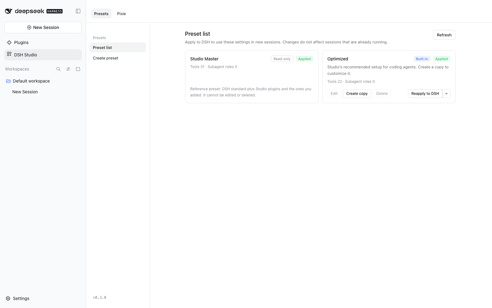

The list shows every preset Studio manages:

| Preset | What it is |
|---|---|
| **Studio Master** | Read-only reference. It follows the running DSH `standard` preset and adds the plugins Studio provides (`read_batch`, `spill-policy` and others) plus any you add. Use it to see which tools and plugins you can select. |
| **Optimized** | Built-in starting point for coding agents: a fixed list of 27 tools, tuned tool descriptions and execution defaults, short working instructions, and a **Worker** role for delegated work. You can edit it and restore the defaults at any time; it cannot be deleted. See [Adapt Optimized to your work](#adapt-optimized-to-your-work). |
| Your presets | Anything you create or copy. |

Each card shows its status — **Applied**, **Needs reapply** (saved changes not yet in DSH), or **Not applied** — and the number of tools and subagent roles. The card buttons:

- **Edit** opens the preset in the editor.
- **Create copy** opens a new, unsaved preset prefilled from this one. Copies can be copied again.
- **Delete** removes the preset from Studio and from DSH. Existing conversations are kept. Optimized cannot be deleted.
- **Restore defaults** (Optimized only) replaces tools, instructions, tool descriptions, Configs, execution defaults and subagent roles with the current Studio defaults, then applies them to DSH. Your edits are discarded.
- **Apply to DSH / Reapply to DSH** registers the saved preset with DSH. The arrow next to it offers **Unapply from DSH**.

If several presets share a warning, it is shown once above the cards instead of on every card.

While you have not edited Optimized, Studio realigns it with the installed Studio version's defaults and DSH `standard` each time it starts. If Optimized was applied, Studio reapplies it; if you unapplied it, it stays unapplied. An edited Optimized is kept as you saved it and its card shows **Edited**. If the Studio defaults change after that, the card also shows **New defaults**; **Restore defaults** adopts them. Your copies are never changed.

- **Missing features**: if an earlier Studio version left features out when applying (compaction, for example), the card says so. **Restore** shows what will be added and, once you confirm, reapplies the saved settings. Overrides, roles and Pixie Gate links are kept.
- **Tool and Config changes**: when a DSH update or a plugin install or removal changes what is available, a notice appears above the list on the next start. **Review** lists additions (`+`), removals (`-`) and schema changes (`~`) with the preset settings that would be cleaned; **Confirm and clean** removes the missing items from your presets. Nothing changes until you confirm.

## Edit a preset

Choose **Create preset** in the left menu, or **Edit** / **Create copy** on a card. Give the preset a name and an optional one-line description, work through the three tabs, then select **Save preset**. Saving does not change DSH until you apply the preset from the list.

### Prompts & tools

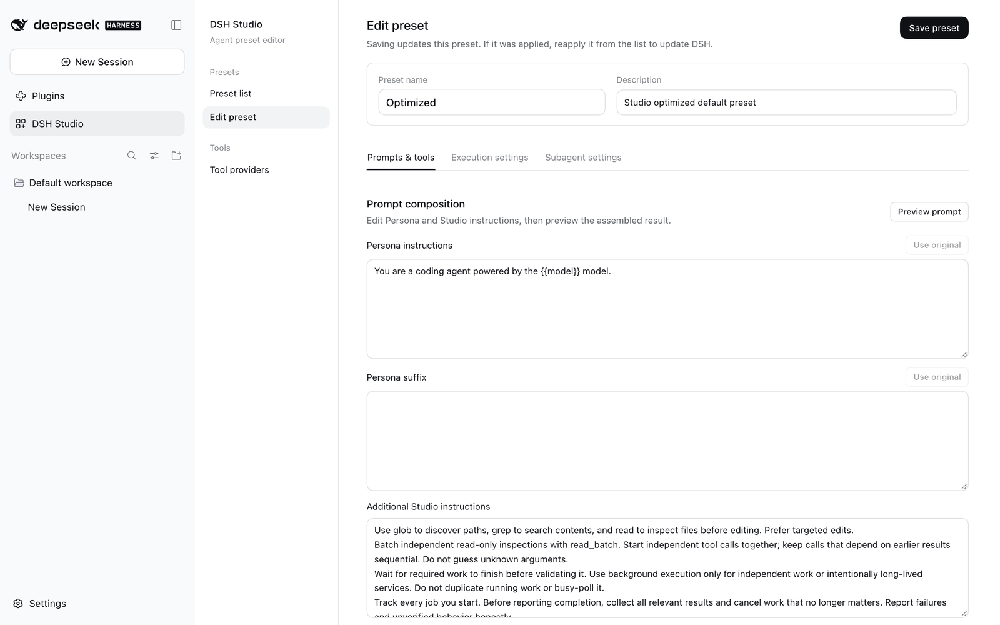

**Prompt composition** controls the instructions the agent starts with:

- **Persona instructions** — the opening identity of the system prompt. `{{model}}` is replaced with the session's model name. **Use original** restores the default.
- **Persona suffix** — text appended at the end of the persona.
- **Additional Studio instructions** — your own working rules, added as the last section of the system prompt.


**Provided tools** decides which tools the agent can call:

- Check a row to include the tool. Rows stay in place when you toggle them.
- **Include a built-in preset tool set** adds or removes the tools of DSH's `standard`, `ptc`, `minimal` or `creator (cordis)` presets in one click. A set shows as pressed when all of its tools are selected.
- Search by name, description or parameter, and filter by **All**, **Selected** or **Modified**.

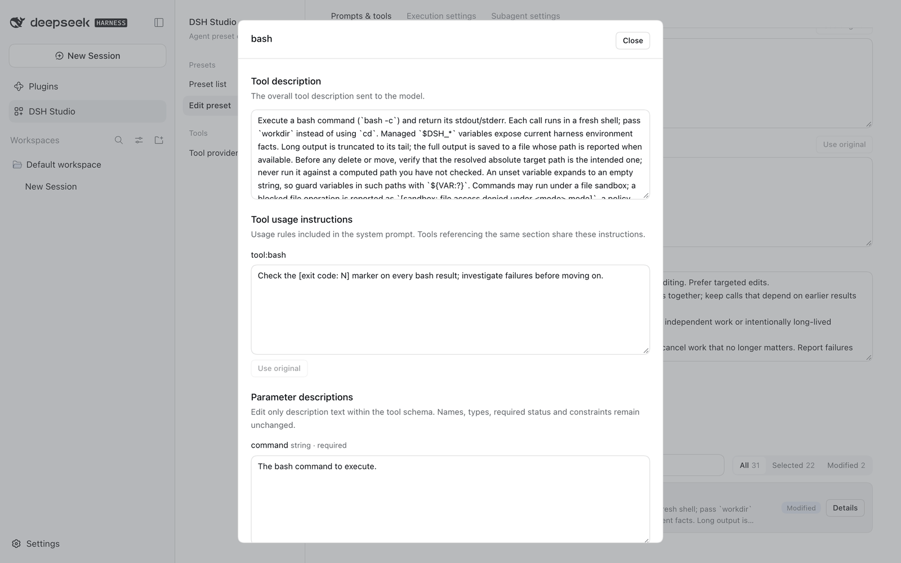

**Details** on a selected tool edits what the model reads about it — never what the tool does:

- **Tool description** — the overall description sent to the model.
- **Tool usage instructions** — the tool's section in the system prompt. Tools that share a section share these instructions.
- **Parameter descriptions** — description text only; names, types and required flags stay unchanged.

Edited tools are marked **Modified**. Changes apply to this preset only.

### Prompt preview

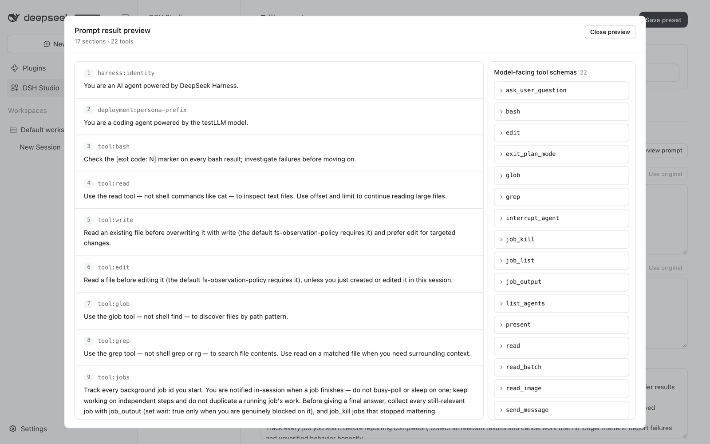

**Preview prompt** shows what DSH sends the model for this preset, without starting an agent or calling a model. Switch between three views at the top:

- **System prompt & tools**: every section in order, with the tools the model receives on the right. Expand a tool to see its description and parameters (name, type, required, description).
- **Runtime context**: the current state appended after the system prompt on every request (permissions, sandbox and so on), by plugin. It depends on session state, so the values are examples.
- **Turn start**: the AGENTS.md instructions, current time and skill list added as conversation messages at each turn. They are examples made with the folder and time Studio runs in now. The text comes from files or the clock and cannot be edited; the settings that shape it (`timeZone`, `maxBytes`, instruction file candidates and so on) are editable right below. They are the same values as Execution settings, and **Reset** returns to the default.

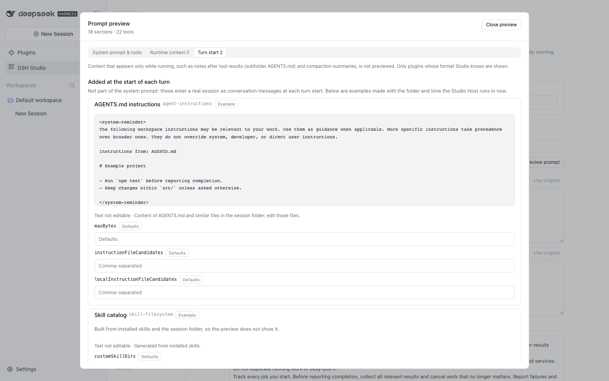

Content that appears only while running, such as notes after tool results (a subfolder AGENTS.md) or compaction summaries, is not previewed. If you change settings while the preview is open, it tells you to run it again.

### Execution settings

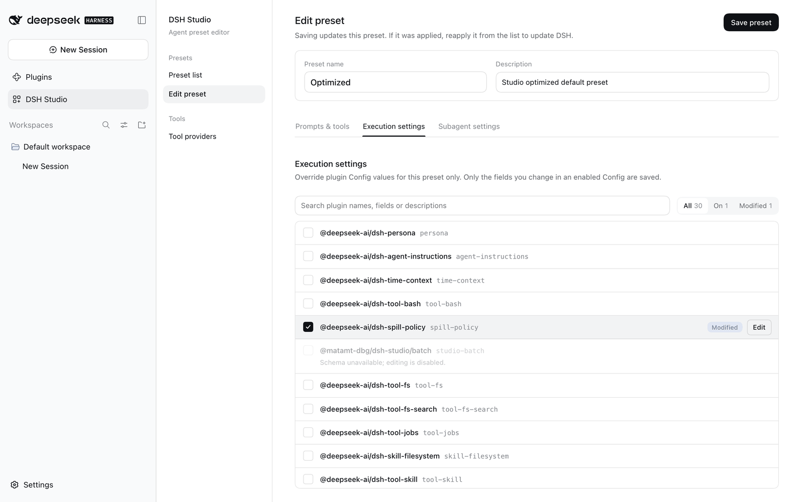

Execution settings has three parts.

**Execution defaults**: the wait times this preset fills in when the model leaves them out (`bash`, `job_output`) and the `read_batch` item limit. Only selected tools are listed, and they work like the Config list below: check an entry and change its value in **Edit**; unchecking removes the override. While a `bash` value is set, the DSH command timeout in **Settings → Shell** does not apply to this preset. Optimized sets both `bash` and `job_output` to 120000 ms. Copies made with an earlier version may still have `bash` at 600000 ms. Preset cards show how many execution defaults a preset overrides.

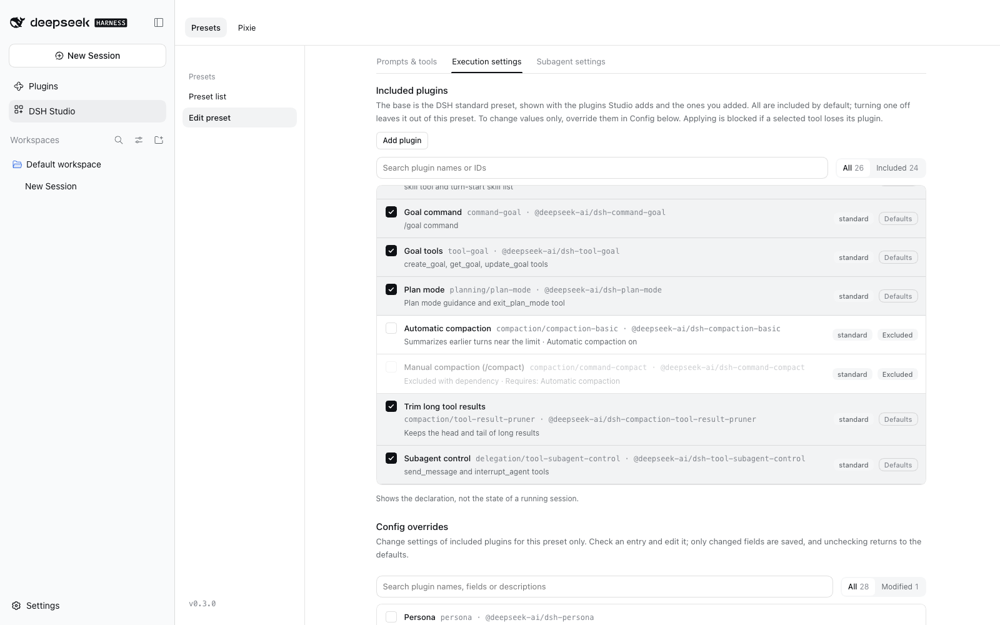

**Included plugins**: every plugin in Studio Master is included in the preset by default. Each row shows its origin (`standard`, `Studio`, `Added`) and state (**Defaults**, **Override**, **Excluded**). Uncheck a row to leave that plugin out of this preset. Plugins that need it leave with it (removing automatic compaction also removes `/compact`). Applying is blocked if a selected tool loses its plugin. New plugins are included from the [Plugins](#plugins-profile-wide-settings) tab; remove ones you already added under **Plugins added by Studio**.

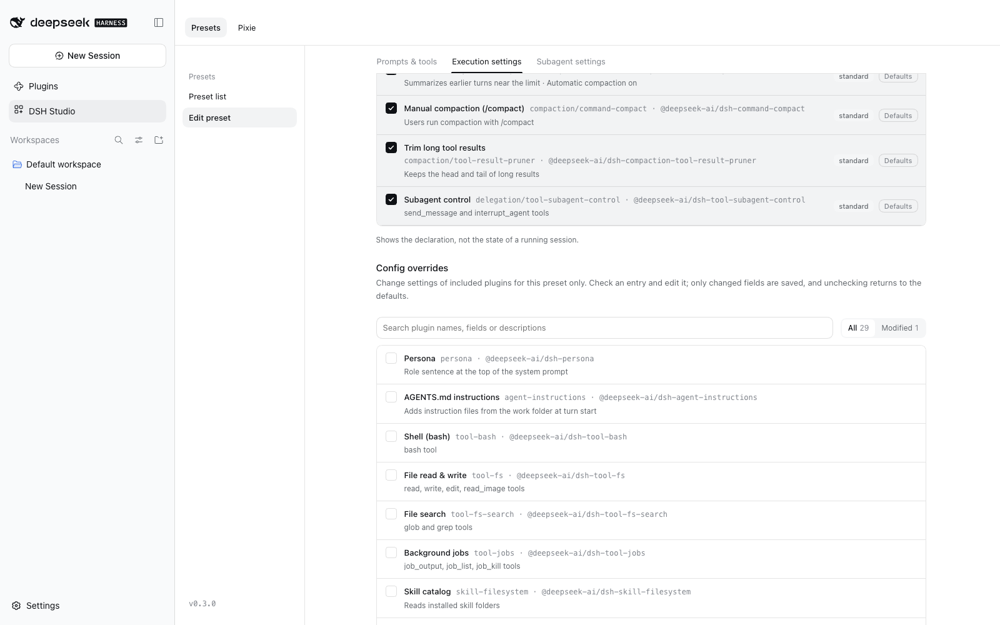

**Config**: override values of included plugins for this preset only — for example, how much tool output stays inline before it is saved to a file (`spill-policy`). Check an entry and **Edit** its fields; only changed fields are saved, and unchecking returns to the defaults. Leaving a plugin out happens in Included plugins above. To turn off only automatic compaction, override `auto` to `false` here (`/compact` stays). Plugins whose settings (schema) cannot be read, such as `read_batch` and `edit_batch`, cannot be edited, and neither can the `tool-subagent` Configs, which `subagent_role` replaces. If Studio set a value for such a plugin (for example, Optimized's `read_batch`), the entry stays on and locked; only restoring the preset defaults changes it.

### Subagent settings

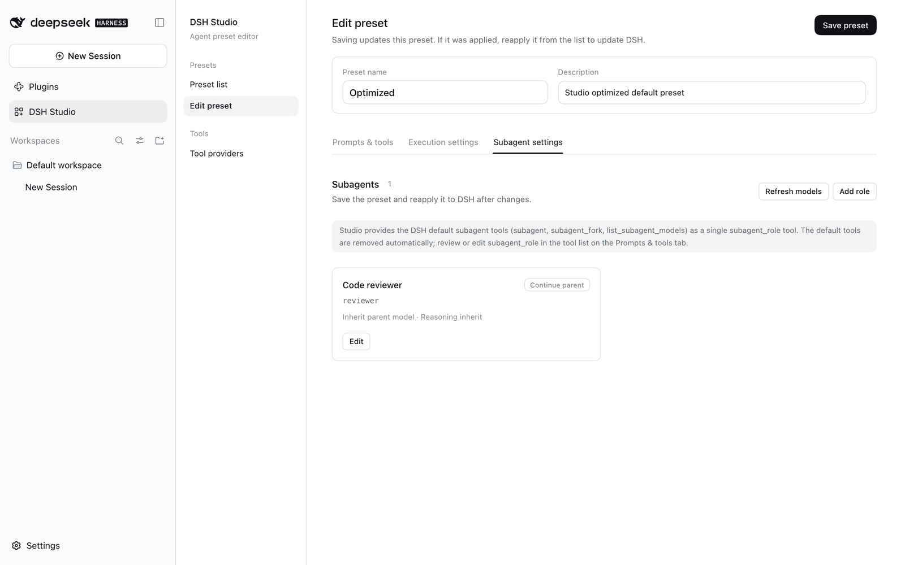

Studio replaces DSH's generic subagent tools (`subagent`, `subagent_fork`, `list_subagent_models`) with a single **`subagent_role`** tool, which keeps the initial prompt smaller. `send_message`, `interrupt_agent` and `list_agents` stay available for following up on, stopping and listing started subagents. You can review or edit the `subagent_role` description in the tool list.

Add **roles** to give the agent named specialists to delegate to:


| Field | Meaning |
|---|---|
| Name | Display name of the role. |
| Role ID | Identifier the agent uses when calling `subagent_role`. Must be unique. |
| Model | **Inherit parent model**, or a specific model from your configured providers. **Refresh models** reloads the list. |
| Reasoning | Reasoning effort supported by the chosen model, or the parent/model default. |
| Spawn mode | **New conversation (Fresh)** starts with only the task; **Continue parent (Fork)** also receives the conversation so far. |
| Role instructions (persona) | Replaces the persona for this role. Leave empty to keep the preset persona, shown as dimmed placeholder text. |
| Subagent Tool Filter | **Use preset default**, **Add to preset default**, or **This role only (ignore default)**. See [Subagent Tool Filter](#subagent-tool-filter). |

The agent writes the actual task each time it calls `subagent_role`. With **no roles**, `subagent_role` starts a fresh subagent with the parent's model, reasoning and preset instructions.

Models are checked when you apply the preset and again before each call, so an unavailable model fails early with a clear message.

Roles set here apply to every session that uses the preset. To change a role in one session only, see [Per-session subagent roles](#per-session-subagent-roles).

#### Subagent Tool Filter

Tools in the **Subagent Tool Filter** are removed from every subagent of this preset. Remove tools a subagent does not need from its system prompt to keep its context light.

- It applies to both **New conversation (Fresh)** and **Continue parent (Fork)**, and to the subagent `subagent_role` starts when no roles are defined. The parent agent keeps every tool.
- A filtered tool disappears from the subagent's tool list together with its description, and calls to it are rejected. Its **Tool usage instructions** are removed from the subagent's system prompt as well; the parent's prompt and your edits on the Prompts & tools tab are unchanged.
- Only tools selected on the **Prompts & tools** tab can be filtered. If you deselect a tool there, it leaves the filter too. The filter is available once `subagent_role` is selected.
- **Per role:** in a role's editor, choose how that role uses the filter:

  | Option | Tools filtered for this role | When you change the preset default |
  |---|---|---|
  | **Use preset default** | The preset default | Follows it |
  | **Add to preset default** | The preset default plus the tools you pick. Default tools are shown locked. | Follows it |
  | **This role only (ignore default)** | Only the tools you pick, starting from an empty list | Not affected |

  Each role card shows its choice, for example `Tool Filter: default + 2`.

##### What each subagent receives

Take a preset that selects `read`, `write`, `edit`, `bash`, `ask_user_question` and `subagent_role`, with the default Tool Filter `ask_user_question`, and two roles: **worker** uses the preset default, **reviewer** adds `write`, `edit` and `bash`. Each agent's system prompt and tool list then look like this:

```text
                      Parent             worker (Fork)        reviewer (Fresh)
                      ─────────────────  ───────────────────  ───────────────────
System prompt
  Persona             ✓                  ✓                    ✓ (role persona if set)
  tool:bash guidance  ✓                  ✓                    ✗ removed
  tool:write guidance ✓                  ✓                    ✗ removed
  tool:edit guidance  ✓                  ✓                    ✗ removed
  Additional Studio
  instructions        ✓                  ✓ unchanged          ✓ unchanged

Tool list
  read                ✓                  ✓                    ✓
  write               ✓                  ✓                    ✗ filtered
  edit                ✓                  ✓                    ✗ filtered
  bash                ✓                  ✓                    ✗ filtered
  ask_user_question   ✓                  ✗ filtered           ✗ filtered
  subagent_role       ✓                  ✓                    ✓
                      ─────────────────  ───────────────────  ───────────────────
                      6 tools            5 tools              2 tools
```

- **✗ filtered**: the tool, its description and its parameter descriptions are gone from the subagent's tool list, and a call to it is rejected.
- **✗ removed**: usage instructions that only filtered tools use are dropped from that subagent's system prompt. Instructions shared with a tool the subagent keeps stay; for example `tool:jobs` stays until `job_list`, `job_output` and `job_kill` are all filtered.
- The parent is never affected, and neither are your edits on the Prompts & tools tab. **Preview prompt** shows the parent.
- Additional Studio instructions reach every subagent unchanged, including sentences that mention a filtered tool.

To confirm this in a running session, see [Appendix: Check a preset in a live session](appendix/preset-check.md).
- Sentences you write in **Additional Studio instructions** are still included. If they contain guidance a subagent does not need, you can move it to the role instructions (persona) or to a tool description.

#### Tips for subagent tools

A subagent sees every tool its parent has unless you filter it. Each tool's description is part of the subagent's prompt, so filtering tools it does not need keeps its context smaller and its choices clearer.

- **Filter tools that talk to the user.** A subagent works on a delegated task and reports back to its parent; it should not interrupt the user. `ask_user_question`, `present` and `exit_plan_mode` are good candidates.
- **Filter tools whose results belong to the parent.** If the parent tracks the plan or decides what to show the user, filter `todo_write` and the goal tools.
- **Give reviewers a read-only toolset.** Choose **Add to preset default** on a reviewer role and add `write`, `edit` and `bash`: it can read and report but not change files, and still loses the default tools.
- **Keep delegation where you want it.** With `send_message`, `interrupt_agent` and `list_agents` filtered, a subagent cannot steer other agents.
- **Check the effect.** The filter applies to subagents only, so **Preview prompt** still shows the parent's tools. Start a session and delegate a task to confirm what the subagent receives.

#### Settings that stay in DSH

The maximum recursion depth and the subagent parallelism limit follow **Built-in plugins → Subagent** in DSH settings. For model selection, the role settings of the Studio preset take precedence. The `tool-subagent` Configs in **Execution settings** are merged into `subagent_role` and cannot be turned on.

The DSH `tool-subagent` Config in **Execution settings** has its own `toolFilter`, but Studio replaces that plugin with `subagent_role`, so set the filter here instead.

## Per-session subagent roles

Without touching the preset, you can change a subagent role's model, reasoning effort, start mode and instructions **for one session only**, or add roles that exist only in that session. Use the **Subagents** tab next to **Chat** and **Trajectory** at the top of the session.

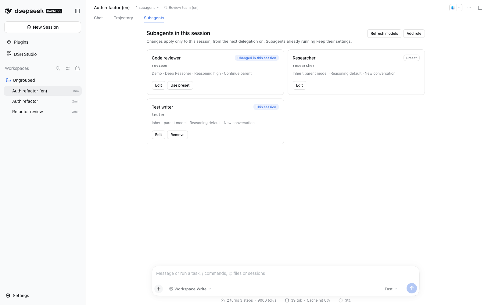

Each card shows where the role comes from:

| Badge | Meaning | Card actions |
|---|---|---|
| **Preset** | The role as the preset defines it. | **Edit** |
| **Changed in this session** | A preset role changed in this session. | **Edit**, **Use preset** |
| **This session** | A role that exists only in this session. | **Edit**, **Remove** |

### Change a role

**Edit** lets you change the model, reasoning effort, start mode and role instructions (persona). Name, role ID and Tool Filter stay as the preset defines them.

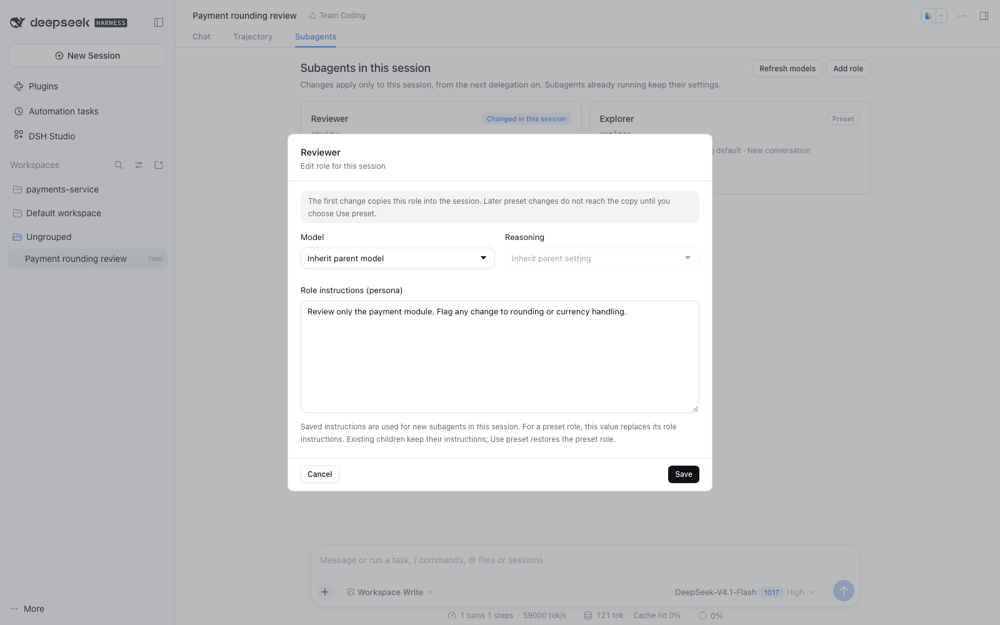

- The first save copies the whole role into this session. Later changes to the preset, including deleting the role, do not reach this copy.
- **Use preset** deletes the copy and returns to the preset's current values.
- The model is checked on save. If it is not available, nothing is saved and your edits stay in the dialog.

### Add a role

**Add role** creates a role for this session only: set its name, role ID, model, reasoning effort and instructions. Such a role defaults to a **new conversation (Fresh)**, can **inherit the parent conversation (Fork)**, and uses the preset's default Tool Filter. A role ID that the preset or this session already uses is rejected. **Remove** it when you no longer need it.

You can add roles even when the preset defines none; `subagent_role` then delegates to them instead of starting a child that matches the parent.

### When and where changes apply

- From the **next delegation** on. Existing subagents keep their settings, including when continued. Fork inherits conversation history but does not guarantee KV cache reuse when changing models.
- Subagents started from this session, and subagents they start in turn, use this session's roles.
- When you open a subagent session, its **Subagents** tab shows the main session's roles read-only. Edit them in the main session.

  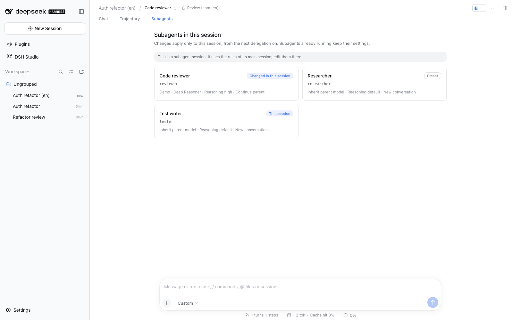

- Other sessions that use the same preset, and the preset itself, are not affected.
- Forking a session does not copy its session roles; the new session starts from the preset.
- In a session whose preset has no Studio `subagent_role`, the tab says **This session has no subagent role tool**.

Session roles are stored per session in `<profile>/studio-data/session-roles/`. Archived sessions keep them; deleting a session removes them.

## Plugins (profile-wide settings)

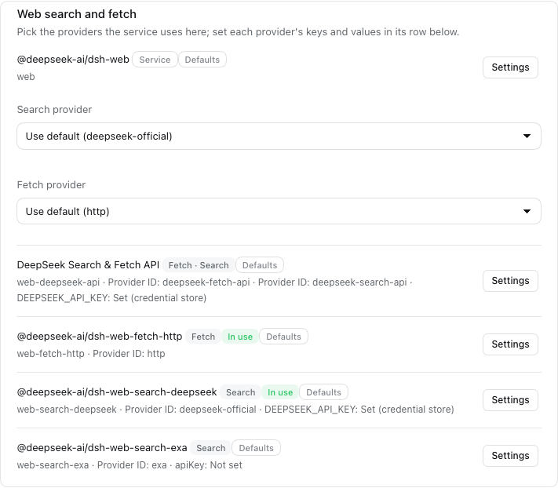

The **Plugins** tab at the top of Studio handles plugins shared by the whole profile (Host). It configures different plugins than presets do.

| Screen | Plugins it configures | Applies to |
|---|---|---|
| Preset › Execution settings › Config | Plugins that run inside a preset composition (tools, automatic compaction, plan mode, ...) | Sessions using that applied preset |
| Plugins › Profile settings | Plugins that run once in the profile (Host) and are shared by every session (web search providers, delegation providers, loop guards, ...) | Every session, as soon as you save |

The same feature can be split by where it runs. For example, the `web_search` tool's timeout is set in the preset's Config, while which provider receives searches (Exa, DeepSeek, ...) is set in Plugins › Profile settings.

**Installed plugins** lists the packages you installed in this profile and where they run.

- **Agent feature** runs per preset. **Set up and include** takes initial settings and adds it to Studio Master; it then appears in the preset's tool and Config lists.
- **Profile-wide** registers into a service every session shares and cannot go into a preset. **Register in profile › Register** adds it to the profile patch file and applies it at once. Then set its values under **Profile settings**. If an earlier version added this plugin to Studio Master, first press **Move** under **Plugins to move out of the base composition**; its settings are backed up to `studio-data/migrated-extensions.json`. While an applied preset still runs the plugin, the row shows **Reapply presets first** and the preset names instead of Register; reapply or unapply those presets, then register.
- **Needs check** means Studio could not confirm where it runs. Check that it works per preset before including it.

Install packages from the DSH **Plugins** page (bundles) or with `dsh plugin --profile <profile> add <package>`.

**Profile settings** groups workflow-related profile settings by category: Web search and fetch, Delegation providers, Loop guards, Goal continuation, Context management (shared), MCP servers, and Model retry and metering. Use the search box to find plugins, categories, or provider IDs.

- Web search and fetch picks a **Search provider** and a **Fetch provider** from the providers that are running. **Use default** removes the override and follows the DSH default (or auto-selection).
- To fetch pages through Exa, install the separate plugin `@matamt-dbg/dsh-web-fetch-exa`, register it in the profile, and choose `exa-contents` as the **Fetch provider**. It uses the same `EXA_API_KEY` as Exa search; put a different key in that row's `apiKey`. Pages arrive as text Exa extracts, billed at Exa Contents per-page pricing.
- For a provider that is not listed, choose **Enter manually** and type its ID; saving an empty value uses the default. Only providers that follow DSH plugin naming conventions (a `providerName`/`serverName` setting, or a `*_PROVIDER_ID` string export) are listed and labeled automatically.
- Secrets such as API keys are never shown; choose **Keep**, **Replace**, or **Delete**. They are stored in plain text in the profile patch file. Plugins that use the DSH credential store (such as the DeepSeek web API with `apiKeyEnv`) show only the key name and status, for example **DEEPSEEK_API_KEY: Set (credential store)**; change that key on the DSH **Plugins › Web search** page.
- Rows that run inside presets (tools, compaction) and infrastructure with little to configure are not listed here. Listed rows with nothing to edit show **No settings**.

## Show DSH in Korean

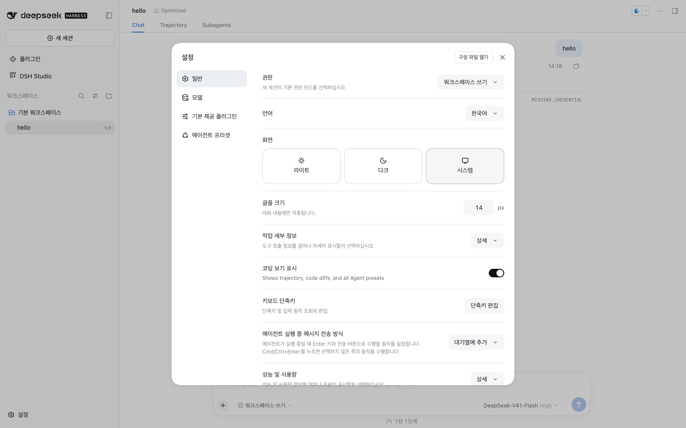

Installing Studio adds **한국어** (Korean) to DSH's language list. Choose it in DSH **Settings → General → Language**, and DSH's own screens — chat, sidebars, settings, plugin manager, Trajectory and more — switch to Korean along with Studio. Studio translates 2,610 of the 2,779 client strings in DSH `0.2.0-rc.2` and `0.2.1-alpha.2`. On DSH `0.2.1-rc.2`, 2,710 of its 2,910 client strings are translated, including the plugin market, web search settings and the newer model settings. 74 strings without a natural translation yet stay in English. Three plugin-manager messages follow `0.2.1-rc.1` and later, so on `0.2.0-rc.2` and `0.2.1-alpha.2` they show a placeholder such as `{reason}` as text.

- Untranslated strings stay in English: 58 strings without a natural translation yet, plus app names, units and format strings that are kept as they are.
- Tab names Chat and Trajectory and product names such as DeepSeek, DSH and MCP stay in English.
- Desktop app menus and dialogs, and text the DSH Host sends (tool descriptions, error messages), cannot be changed by a plugin and stay in English.
- If DSH later ships Korean for a screen, that screen uses DSH's translation and the rest keep Studio's.

## Studio shortcuts (SettingsX)

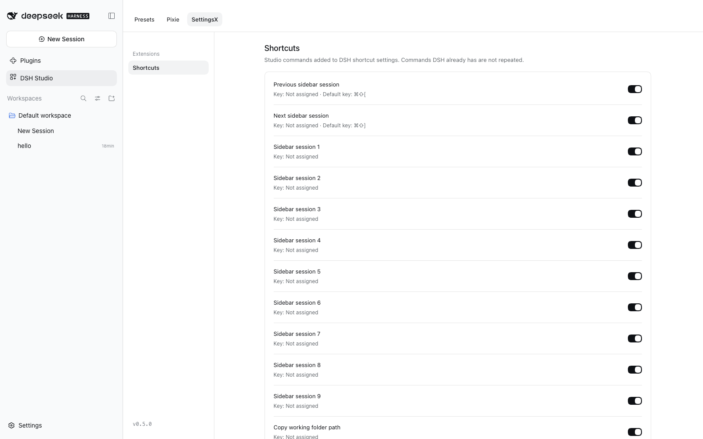

**DSH Studio → SettingsX → Shortcuts** lists keyboard commands that Studio adds to DSH's shortcut catalog. Commands DSH already has are not repeated. Assign or change keys in DSH **Settings → General → Keyboard shortcuts**; turn a command off here to remove it from DSH's list too.

| Command | What it does | Default key |
|---|---|---|
| Previous / next session | Moves through sessions in sidebar order, wrapping at the ends | ⌘⇧[ / ⌘⇧] on the macOS desktop app; none on the web |
| Go to session 1–9 | Opens the nth session in the sidebar | none |
| Copy working folder | Copies the current session's working folder path | none |
| Toggle full screen | Toggles browser full screen for the page | none |

- Session commands follow the sidebar order, including pinned sessions, manual order and folder trees; collapsed groups and the "show more" limit are ignored. They do nothing while lists load or a dialog is open.
- On the web, Chrome uses ⌘⇧[ / ] for tabs first, so assign another key such as ⌃⇧[ / ].
- On/off choices are saved in this browser only.

## Adapt Optimized to your work

Optimized is tuned for **coding-agent work**: reading and editing code, running commands, and checking results. The main agent has every tool, including delegation, questions, `judge` and `pixie_loop`. The default **Worker** role inherits the same instructions and execution defaults but leaves those tools out and only does the work it is given.

You can **Edit** Optimized directly, or **Create copy** to keep separate presets for different kinds of work. An edited Optimized can always go back to the Studio defaults with **Restore defaults**. Copies do not follow later Studio defaults.

| If you want to… | Change this |
|---|---|
| Track long, multi-step objectives | Turn on the goal and todo tools (`create_goal`, `get_goal`, `update_goal`, `todo_write`) in **Prompts & tools**. |
| Manage DSH plugins | Turn on `plugin_manager`. The inspection tools (`cordis_inspect_list`, `cordis_inspect_query`) are already on. |
| Work with Office files or data using the app's bundled Python and Node | Turn on `load_workspace_dependencies` (desktop app profile only; see [Tools that depend on your profile](#tools-that-depend-on-your-profile)). |
| Search X, or generate images and videos | Turn on `x_search`, `image_generate` or `video_generate` (only when a plugin in your profile provides them). |
| Do research, writing or operations instead of coding | Rewrite **Additional Studio instructions** for that work, and drop tools it does not need. |
| Let the DSH shell setting decide how long commands wait | Turn off **bash command wait** in **Execution settings → Execution defaults**. |
| Change how much tool output stays inline | Adjust `spill-policy` in **Execution settings**. |
| Tune any other plugin behavior | Turn on that plugin in **Execution settings → Config** and edit only the fields you need. |
| Leave a feature out entirely | Uncheck it in **Execution settings → Included plugins**. |
| Steer how the model uses a tool | Edit its description, usage instructions or parameter text in the tool's **Details**. |
| Delegate to specialists | Add roles in **Subagent settings** with their own model, reasoning effort and persona. |
| Change a role's model or instructions for one task only | Use the session's **Subagents** tab; the preset stays as it is. See [Per-session subagent roles](#per-session-subagent-roles). |
| Keep subagents focused | Add tools such as `ask_user_question` to the **Subagent Tool Filter**, or give a role its own list. See [Subagent Tool Filter](#subagent-tool-filter). |

Use **Preview prompt** after each change to confirm what the model will receive, then save and apply. You can keep several presets for different kinds of work.

## Apply a preset to DSH

1. Save the preset.
2. In **Preset list**, select **Apply to DSH** (or **Reapply to DSH** after changes).
3. Start a new session and choose the preset in DSH's preset picker.

An applied preset also appears under **CUSTOM** in DSH **Settings → Agent presets**. Select its card to make it the default for new tasks; it then shows **New task default**.

If applying fails, the previously applied version stays in effect and the list explains why. **Unapply from DSH** removes the preset from DSH but keeps it in Studio.

## Tools that depend on your profile

Studio Master lists only the tools that the plugins in **this profile** register. Some tools come from plugins that only certain environments load. For example, the desktop app adds `load_workspace_dependencies`, `x_search`, `image_generate` and `video_generate`, but a `dsh web` profile or a headless runtime may not have them. Optimized never selects these tools, so it works in every profile.

When a selected tool is missing from the profile:

- In the editor, the tool is marked **Not available in this profile**.
- Applying the preset fails, and the previously applied version stays in effect.
- An already applied preset keeps working without that tool after DSH restarts, and the list shows a notice. Other tool calls are not blocked.

The tools a preset selects are the session's **starting tool set**. Tools that another plugin registers under a new name after the session starts, and tools DSH attaches to each session directly (such as schedules), are not blocked by Studio and can be used as is. These tools do not appear in the preset tool list.

To use such a tool, install the plugin that provides it in that profile, or add it to Studio Master with **Execution settings → Included plugins → Add plugin**. If you work in several profiles, keep a separate copy for each profile and turn on only the tools that profile provides.

## Where data is stored

Presets are saved per DSH profile in `<profile>/studio-data/`. Per-session subagent roles are saved per session under `session-roles/` there. Applying a preset registers a Studio-owned DSH agent preset; Studio never edits DSH's own presets or your profile's package list.

On DSH `0.2.1-rc.1` and later, each role child's instructions and Tool Filter are saved at creation under `child-policies/`. Keep this directory when backing up or moving a profile: completed children also use it when continued. A missing or invalid policy file prevents that child from running. Later role edits do not change an existing child's policy. Running role children this way was tested on `0.2.1-rc.1`; on `0.2.1-rc.2`, only saving and reapplying roles was tested.

## Troubleshooting

**"@matamt-dbg/dsh-studio: failed" after installing.** An earlier local build of Studio (`@local/dsh-studio`) is still installed in the same profile, and both try to register the same page. Remove the old one and restart:

```sh
dsh plugin --profile web remove @local/dsh-studio
```

Your saved presets are kept and migrated automatically.

**A preset shows "Needs reapply".** It was saved after it was last applied. Apply it again to update DSH.

**Applying fails with "does not supply tools" or "not provided by this composition", or the list notes "selected tools unavailable".** The preset selects a tool that this profile does not provide, such as `load_workspace_dependencies` outside the desktop app, or you excluded the plugin that provides it. Install or include the plugin, or turn the tool off in your copy and apply again. See [Tools that depend on your profile](#tools-that-depend-on-your-profile).

**Some text is still English after choosing Korean.** It is either not translated yet or sent by the DSH Host or desktop app. See [Show DSH in Korean](#show-dsh-in-korean).

**Optimized has different tools or plugins after an update.** This is expected: an unedited Optimized follows the installed Studio version's defaults and DSH `standard`. An edited Optimized and your copies keep their own tools.

**The Optimized card shows "New defaults".** The Studio defaults changed after you edited Optimized. Leave it to keep your settings, or select **Restore defaults** to adopt the new defaults; your edits are then discarded.
