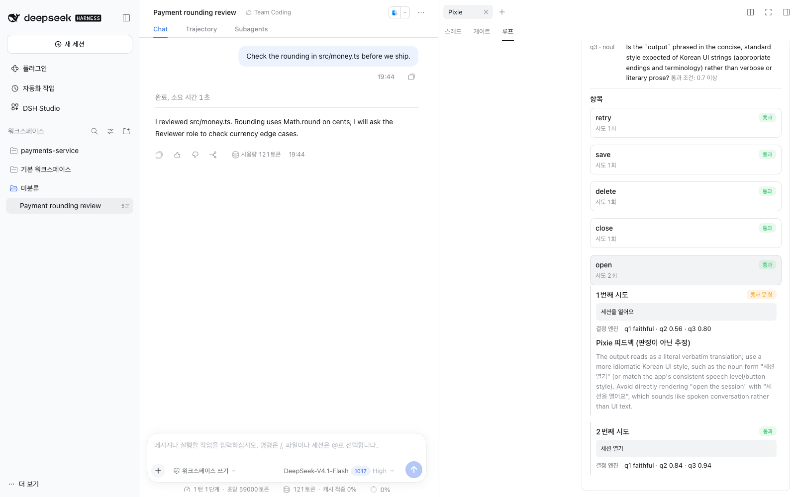
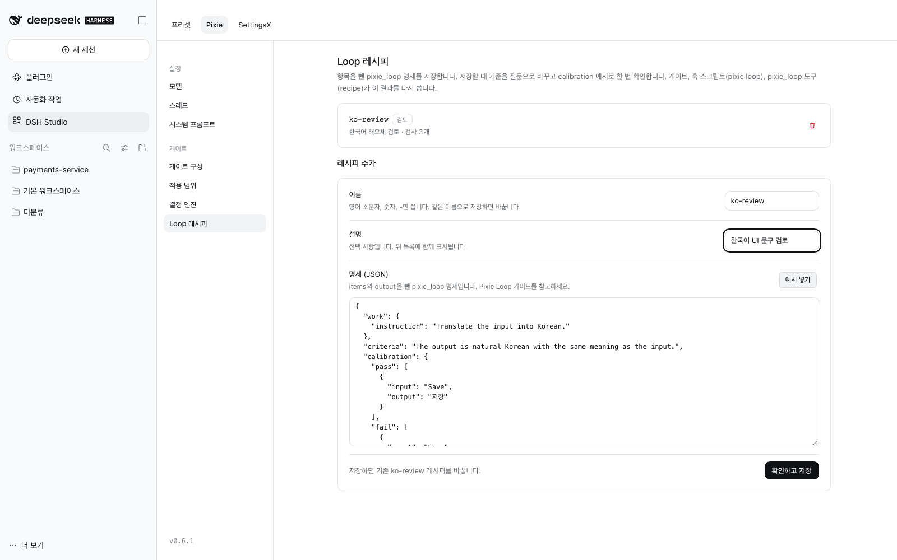

# DSH Studio 0.6.4 새 기능

[English](highlights.md) | 한국어

DSH `0.2.0-rc.2`, `0.2.1-alpha.2`, `0.2.1-rc.1` 또는 `0.2.1-rc.2`가 필요합니다. 자세한 변경 사항은 [변경 기록](../CHANGELOG.md)에서 확인할 수 있습니다.

이 페이지에서는 0.6.2부터 0.6.4까지의 변경 사항을 다룹니다. 0.6.1의 새 기능은 아래에서 이어서 설명합니다.

- **플러그인 탭** (0.6.3): 프로필에 설치한 플러그인을 찾아 에이전트 기능과 프로필 공용 플러그인으로 나누고, 프로필 공용 플러그인을 한 번에 등록하며, 공용 Host 설정을 워크플로우별로 묶어 보여 줍니다.
- **Exa 웹 검색·가져오기** (0.6.3–0.6.4): 목록에서 선택해 Exa로 검색하고 Exa로 페이지를 가져옵니다. 페이지 가져오기 기능은 새로운 별도 플러그인 `@matamt-dbg/dsh-web-fetch-exa`에서 제공합니다.
- **Studio와 함께 배포하는 별도 플러그인**: Studio 자체 기능에 필요 없는 플러그인은 자체 버전을 가진 별도 npm 패키지로 배포하며, DSH 플러그인 페이지에서 설치합니다.
- **Optimized 조정, Worker 역할, 실행 기본값** (0.6.2).

## 플러그인 탭

**DSH Studio → 플러그인**에서는 프리셋과 별도로 프로필 전체가 공유하는 플러그인을 다룹니다.


- **설치한 플러그인**에는 프로필에 설치된 플러그인 패키지와 실행 범위가 표시됩니다. **에이전트 기능**은 프리셋마다 따로 동작합니다. **설정하고 포함**으로 초기 설정을 넣으면 Studio Master에 추가되어 각 프리셋의 도구와 Config에 나타납니다. **프로필 공용** 플러그인은 웹 검색 공급자처럼 모든 세션이 공유하는 서비스에 등록되므로 프리셋에 넣을 수 없습니다. **확인 필요**는 Studio가 실행 범위를 확인하지 못한 플러그인입니다.
- **프로필에 등록하기 › 등록**을 누르면 프로필 공용 플러그인을 프로필 설정 파일에 추가하고 재시작 없이 적용합니다. 활성화에 실패하면 파일을 원래대로 되돌립니다. DSH 번들로 배포되는 플러그인은 설치하면 자동으로 추가되므로 등록할 필요가 없습니다.
- **프로필 설정**에서는 Host에서 한 번만 실행되고 모든 세션이 공유하는 항목을 모아 보여 줍니다. 웹 검색·가져오기, 위임 공급자, 루프 가드, 목표 자동 진행, 컨텍스트 관리(공용), MCP 서버, 모델 재시도·측정 항목이 있습니다. 저장하면 실행 중인 모든 세션에 적용됩니다.
- API 키 같은 비밀 값은 화면에 보이지 않습니다. **유지**, **교체**, **삭제** 중에서 고릅니다. 두 페이지 모두 검색 칸이 있습니다.

[플러그인 (프로필 공용 설정)](guide.ko.md#플러그인-프로필-공용-설정)을 참고하세요.

## Exa 웹 검색·가져오기

웹 검색·가져오기 카드에서는 실행 중인 공급자 중 **검색 공급자**와 **가져오기 공급자**를 선택합니다. Exa 플러그인 두 개를 함께 사용하면 `web_search`와 `web_fetch`가 모두 Exa를 거칩니다.

| 플러그인 | 공급자 ID | 도구 |
| --- | --- | --- |
| `@deepseek-ai/dsh-web-search-exa` (DSH) | `exa` | `web_search` |
| `@matamt-dbg/dsh-web-fetch-exa` (새 별도 플러그인) | `exa-contents` | `web_fetch` |

1. 플러그인을 설치합니다. `npm i`로는 DSH에 설치되지 않습니다.
   - `dsh-web-fetch-exa`: DSH의 **플러그인 → 플러그인 추가**에서 설치하거나 `dsh plugin --profile <프로필> add @matamt-dbg/dsh-web-fetch-exa` 명령으로 설치합니다. 공급자 행은 자동으로 추가됩니다.
   - `dsh-web-search-exa`: `dsh plugin --profile <프로필> add @deepseek-ai/dsh-web-search-exa`로 설치한 뒤(DSH 번들이 아니어서 플러그인 페이지에서는 설치할 수 없습니다) **Studio → 플러그인 → 설치한 플러그인 → 프로필에 등록하기**를 누릅니다.
2. **프로필 설정**에서 각 플러그인 행의 `apiKey`를 입력하거나 `EXA_API_KEY`를 설정합니다. 한 행에 저장된 키는 다른 행과 공유되지 않습니다.
3. 검색 공급자는 `exa`, 가져오기 공급자는 `exa-contents`로 고릅니다. 고르기 전까지 `web_fetch`는 지금 쓰는 공급자를 그대로 씁니다.

`exa-contents`는 Exa가 추출한 페이지 텍스트를 반환하며, Exa Contents 요금은 페이지 단위로 부과됩니다. 키가 없으면 `configured web provider "exa-contents" is registered but unavailable` 오류가 발생합니다. [Exa로 웹 검색·가져오기](guide.ko.md#exa로-웹-검색가져오기)를 참고하세요.

## Studio와 함께 배포하는 별도 플러그인

일부 기능은 Studio 패키지에 포함되어 있지 않습니다. 이러한 기능은 자체 버전과 변경 기록을 가진 별도의 npm 패키지로 배포되며, 소스는 Studio 저장소의 [`plugins/`](https://github.com/matamt-dbg/dsh-studio/tree/main/plugins) 폴더에 있습니다. Studio는 이 플러그인을 인식하지만, Studio를 설치하거나 업데이트하더라도 함께 설치되지는 않습니다.

- 첫 플러그인은 `@matamt-dbg/dsh-web-fetch-exa` 0.1.1입니다. 0.1.1부터는 DSH 번들이므로 **플러그인 → 플러그인 추가**에서 설치할 수 있고, 공급자 행도 자동으로 추가됩니다. 0.1.0은 "declares no dsh.bundle"으로 설치가 거부되었습니다.
- npm 패키지 페이지에 표시되는 설치 명령(`npm i …`)으로는 DSH에 플러그인이 설치되지 않습니다. DSH 플러그인 페이지를 사용하거나 `dsh plugin add`를 실행하세요.

## Optimized, Worker 역할, 실행 기본값

- **벤치마크를 바탕으로 Optimized를 조정했습니다** (0.6.2). `edit_batch`(한 파일에 대한 여러 수정을 한 번의 원자적 쓰기로 처리)를 추가하고, `read_batch`의 줄 수 제한을 없앴으며, `bash` 대기 시간을 600초에서 120초로 줄이고, 공통 지침을 짧게 바꿨습니다. 기본 **Worker** 서브에이전트 역할은 이 설정을 그대로 물려받지만 위임, 질문, `judge`, `pixie_loop`, `cordis_inspect_*`는 쓸 수 없습니다.
- **Optimized를 편집하고 되돌릴 수 있습니다.** **기본값 복원**을 누르면 현재 Studio 기본값으로 돌아갑니다. 편집하지 않은 Optimized는 새 기본값을 자동으로 따르고, 편집한 Optimized에는 **편집됨**이 표시되며 나중에 기본값이 바뀌면 **새 기본값**도 표시됩니다.
- **실행 기본값**(`bash` `timeoutMs`, `job_output` `timeout_ms`, `read_batch` 제한)은 **실행 설정**에서 따로 목록으로 보여 주며, 프리셋 카드에는 덮어쓴 개수가 표시됩니다.

## 업그레이드 전에

- 이전 버전에서 프로필 공용 플러그인(예: `@deepseek-ai/dsh-web-search-exa`)을 Studio Master에 추가했다면, 설치한 플러그인 페이지에 **기준 구성에서 옮겨야 하는 플러그인**이 표시됩니다. **옮기기**를 누르면 설정을 `studio-data/migrated-extensions.json`에 백업합니다. 그다음 프로필에 등록하세요.
- 프로필 설정에서 저장한 값은 비밀 값을 포함해 프로필의 `cordis.patch.yml`에 평문으로 기록됩니다.
- 0.6.2에서는 Optimized 사본이 갱신되지 않습니다. 새 기본값을 사용하려면 Optimized를 다시 복사하세요.
- 먼저 프로필을 백업하세요. DSH 버전별로 확인한 내용은 [변경 기록](../CHANGELOG.md)에 있습니다.

## 이전: 0.6.1

0.6.0은 GitHub에만 공개하고 npm에는 올리지 않았습니다. 0.6.1에는 0.6.0의 변경 사항이 포함되며, 새 DSH 버전 지원과 몇 가지 수정을 더했습니다.

- **Pixie Loop**: 여러 항목에 대해 작업 → 검사 → 판정 → 재시도 과정을 에이전트 대화 밖에서 반복합니다.
- **세션별 서브에이전트 역할**: 프리셋을 건드리지 않고 이번 작업에서만 역할을 바꿉니다.
- **DSH 화면 한국어**: Studio와 함께 DSH 자체 화면도 한국어로 봅니다.
- **Studio 단축키**: DSH에 없는 키보드 명령을 더합니다.
- **새 DSH 지원**: DSH `0.2.1-rc.1`, `0.2.1-rc.2`를 지원합니다. 이제 Studio가 역할 서브에이전트의 지침과 Tool Filter를 직접 적용합니다.

### Pixie Loop

UI 문구 번역, 릴리스 노트 다듬기, 파일별 점검처럼 여러 항목을 같은 규칙으로 처리해야 할 때는 에이전트가 묶음 전체를 새 `pixie_loop` 도구에 넘깁니다. 루프는 항목마다 **작업 → 정확한 검사 → 결정 엔진 판정 → Pixie 피드백 → 재시도**를 에이전트 대화 밖에서 돌립니다. 에이전트는 통과 수, 결과 파일, 끝내 통과하지 못한 항목만 돌려받습니다.



#### 예시: UI 문구 번역

위 실행은 에이전트에게 한 번 요청한 결과입니다.

> `items.jsonl`의 문구 다섯 개를 `pixie_loop`으로 한국어 UI 문구로 번역해 줘. 자리표시자는 그대로 두고, 문장은 해요체로.

에이전트는 아래 명세를 써서 `pixie_loop`에 넘겼습니다.

```json
{
  "items": { "path": "items.jsonl" },
  "work": { "instruction": "Translate the English UI string to natural Korean UI text. Keep placeholders exactly." },
  "shared": "Glossary: session → 세션. Use polite 해요체 for sentences.",
  "criteria": "The Korean keeps the full meaning of the English. It is natural Korean UI text. If there is a problem, say whether it is a mistranslation, omission, or unnatural wording.",
  "codeChecks": [{ "type": "placeholders" }, { "type": "regex", "pattern": "[가-힣]", "expect": "match" }],
  "calibration": {
    "pass": [{ "input": "Save {name}", "output": "{name} 저장" }],
    "fail": [{ "input": "Do not retry on 4xx", "output": "4xx에서도 재시도" }]
  },
  "limits": { "tokens": 300000, "timeMs": 600000 },
  "output": "loop-done.jsonl"
}
```

1. **시작하기 전에** Pixie가 기준을 고정된 질문으로 바꾼 다음, 결정 엔진이 통과 예시와 실패 예시를 구별할 수 있는지 확인합니다. 구별하지 못하면 실행을 시작하지 않습니다.
2. **항목마다** 번역하고, 자리표시자와 한글 포함 여부를 검사한 뒤 판정합니다. `Open the session`은 처음에는 `세션을 열어요`로 번역되었습니다. 결정 엔진이 UI 문구로서의 자연스러움 점수를 기준보다 낮게 매기자 Pixie가 명사형을 제안했고, 다음 시도인 `세션 열기`가 통과했습니다.
3. **에이전트는** `5개 통과, 0개 넘김`과 결과 파일만 받습니다. 시도와 점수는 대화가 아니라 **Pixie 탭 → 루프**에 남습니다.

`act`는 각 출력을 세션의 `bash` 도구로 실행하고, 그 결과를 기준으로 판정합니다(예: 페이지에서 CSS 셀렉터를 시험). `mode: "episode"`는 목표에 도달할 때까지 한 단계씩 진행하며, `select`는 결정 엔진이 후보 중 하나를 고르도록 합니다. [Pixie Loop 가이드](appendix/pixie-loop.ko.md)를 참고하세요.

#### Loop 레시피

자주 쓰는 명세는 **DSH Studio → Pixie → 게이트 → Loop 레시피**에 **레시피**로 저장합니다. 저장할 때 검사를 한 번 확인합니다. 에이전트는 `pixie_loop`(`recipe`)로 실행하고, 게이트는 레시피로 판정하며, 훅 스크립트는 `pixie loop --recipe <이름>`을 호출합니다. **예시 넣기**를 누르면 바로 쓸 수 있는 명세가 채워지고, 잘못된 이름은 입력할 때 바로 알려 주며, 저장하면 기존 레시피를 바꾸게 될 때도 미리 알려 줍니다.



항목의 내용은 Pixie 모델 제공자와 결정 엔진으로 전송됩니다.

### 세션별 서브에이전트 역할

프리셋을 건드리지 않고 **이번 작업에서만** 서브에이전트 역할을 바꿉니다. 세션 위쪽 **Chat**, **Trajectory** 옆의 새 **Subagents** 탭에 그 세션의 역할이 나옵니다.


- **역할의 모델·추론 수준·지침을 바꾸거나**, 이 세션에서만 쓸 역할을 추가합니다. 프리셋과 다른 세션은 그대로입니다.
- **세션의 복사본은 따로 움직입니다.** 처음 바꿀 때 역할 전체가 세션에 복사되고, 이후 프리셋을 고쳐도 **프리셋 값 사용**을 누르기 전까지 바뀌지 않습니다.
- **서브에이전트는 메인 세션을 따릅니다.** 세션에서 시작한 서브에이전트와 그 서브에이전트가 다시 시작한 서브에이전트도 같은 역할을 씁니다. 서브에이전트 세션에서는 읽기 전용으로 보입니다.


저장한 지침은 이 세션에서 새로 만드는 서브에이전트의 역할 지침으로, 프리셋 역할 지침 대신 사용됩니다. 이미 만든 서브에이전트의 지침은 바뀌지 않습니다. [세션별 서브에이전트 역할](guide.ko.md#세션별-서브에이전트-역할)을 참고하세요.

### DSH 화면 한국어

DSH **설정 → 일반 → 언어**(영어 화면에서는 **Settings → General → Language**)에서 **한국어**를 고르면 Studio와 함께 DSH 자체 화면도 한국어로 바뀝니다. 대화, 사이드바, 설정, 플러그인 관리, Trajectory 등이 모두 해당합니다.


- DSH `0.2.0-rc.2`·`0.2.1-alpha.2`의 클라이언트 문구 **2,779개 중 2,610개**를 번역했습니다. 번역한 문구는 판정 엔진으로 자연스러움·의미·문체를 확인했습니다. 앱 이름·단위·형식 문자열은 번역하지 않고 그대로 두며, 아직 자연스러운 번역을 찾지 못한 문구는 영어로 둡니다.
- **DSH `0.2.1-rc.1`·`0.2.1-rc.2`도 번역했습니다.** DSH `0.2.1-rc.2`에서는 클라이언트 문구 2,910개 중 2,710개를 번역했습니다. 플러그인 마켓, 웹 검색 설정, 새 모델 설정이 포함됩니다. 자연스러운 번역을 찾지 못한 74개는 영어로 둡니다. 플러그인 관리의 안내 문구 3개는 `0.2.1-rc.1` 이후 기준이라, `0.2.0-rc.2`·`0.2.1-alpha.2`에서는 `{reason}` 같은 자리표시자가 글자 그대로 보입니다.
- 데스크톱 앱의 메뉴와 대화상자, 도구 설명이나 오류 메시지처럼 DSH Host가 보내는 문구는 플러그인이 바꿀 수 없어 영어로 남습니다.
- 나중에 DSH가 어떤 화면에 한국어를 직접 넣으면 그 화면은 DSH의 번역을 씁니다.

[DSH 화면을 한국어로 보기](guide.ko.md#dsh-화면을-한국어로-보기)를 참고하세요.

### Studio 단축키 (SettingsX)

**DSH Studio → SettingsX → 단축키**에서 DSH에 없는 키보드 명령을 더합니다.


| 명령 | 기본 키 |
|---|---|
| 사이드바 순서로 이전 / 다음 세션 | ⌘⇧[ / ⌘⇧] (macOS 데스크톱 앱) |
| 세션 1–9로 이동 | 없음 |
| 세션의 작업 폴더 복사 | 없음 |
| 전체 화면 전환 | 없음 |

단축키는 DSH 단축키 설정에서 지정합니다. 명령 사용 여부는 SettingsX 페이지에서 설정합니다. 다른 플러그인이 같은 기본 키를 이미 쓰면 그 명령만 키 없이 추가되고, 다른 명령은 그대로 동작합니다. [Studio 단축키](guide.ko.md#studio-단축키-settingsx)를 참고하세요.

### 새 DSH 버전

- **DSH `0.2.1-rc.1`, `0.2.1-rc.2`를 지원합니다.** 이 버전부터 DSH는 서브에이전트를 시작할 때 역할 지침과 Tool Filter를 적용하지 않습니다. 따라서 Studio는 역할 서브에이전트를 만들 때 지침과 Tool Filter를 저장해 두고, 실행 전에 직접 적용합니다. Fresh와 Fork 모두 마찬가지입니다.
- 이 지침과 Tool Filter를 사용해 역할 서브에이전트가 실제로 실행되는 것을 `0.2.1-rc.1`에서 확인했습니다. `0.2.1-rc.2`에서는 Studio가 여기에 사용하는 API가 변경되지 않았으며, 역할 저장·재적용까지만 확인했습니다.
- 이 값은 `<프로필>/studio-data/child-policies/`에 저장되고, 종료된 서브에이전트를 이어서 실행할 때에도 다시 사용됩니다. **프로필을 백업하거나 옮길 때는 이 폴더도 함께 보존해야 합니다.** 파일이 없거나 손상된 경우 해당 서브에이전트는 실행되지 않습니다.

### 0.5에서 업그레이드하기 전에

- 개발자 도구(Trajectory)를 꺼 두어도 모든 세션에 **Chat / Subagents** 탭 표시줄이 나타납니다.
- 모델이 보는 `subagent_role` 도구 문구가 모든 프리셋에서 조금 달라졌습니다.
- 먼저 프로필을 백업하세요. 각 DSH 버전에서 무엇을 확인했는지는 [변경 기록](../CHANGELOG.md)에 있습니다.
