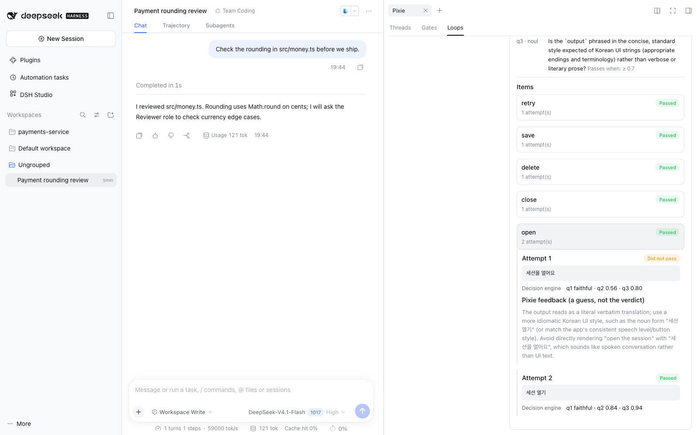
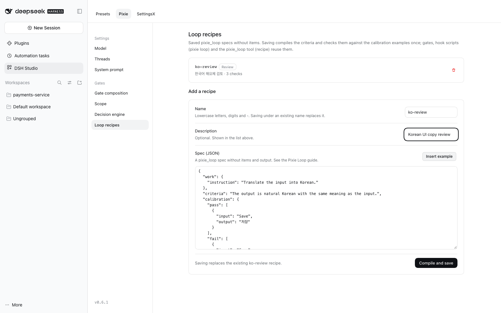

# What's new in DSH Studio 0.6.4

English | [한국어](highlights.ko.md)

Requires DSH `0.2.0-rc.2`, `0.2.1-alpha.2`, `0.2.1-rc.1` or `0.2.1-rc.2`. Full details are in the [Changelog](../CHANGELOG.md).

This page covers 0.6.2 through 0.6.4. The 0.6.1 highlights follow below.

- **Plugins tab** (0.6.3): Studio finds the plugins installed in your profile, tells agent features from profile-wide plugins, registers profile-wide ones in one click, and groups shared Host settings by workflow.
- **Exa web search and fetch** (0.6.3–0.6.4): search with Exa and read pages with Exa, chosen from a list. Page fetching comes from a new separate plugin, `@matamt-dbg/dsh-web-fetch-exa`.
- **Separate plugins next to Studio**: plugins that Studio's own features do not need ship as their own npm packages with their own versions, installed from the DSH Plugins page.
- **Optimized tuned, Worker role, execution defaults** (0.6.2).

## Plugins tab

**DSH Studio → Plugins** handles plugins shared by the whole profile, separately from presets.


- **Installed plugins** lists the plugin packages in your profile and where they run. **Agent features** run per preset: **Set up and include** takes initial settings and adds the plugin to Studio Master, so it appears in each preset's tools and Config. **Profile-wide** plugins register into a service every session shares, such as a web search provider, and cannot go into a preset. **Needs check** marks plugins whose scope Studio could not confirm.
- **Register in profile › Register** adds a profile-wide plugin to the profile patch file and applies it without a restart. If it fails to activate, the file is restored. Plugins that ship as DSH bundles add themselves when installed and need no registration.
- **Profile settings** groups what the Host runs once for every session: web search and fetch, delegation providers, loop guards, goal continuation, shared context management, MCP servers, and model retry and metering. Saving applies to every running session.
- Secrets such as API keys are never shown; choose **Keep**, **Replace** or **Delete**. Both pages have a search box.

See [Plugins (profile-wide settings)](guide.md#plugins-profile-wide-settings).

## Exa web search and fetch

The Web search and fetch card picks a **Search provider** and a **Fetch provider** from the providers that are running. With two Exa plugins, `web_search` and `web_fetch` both go through Exa:

| Plugin | Provider ID | Tool |
| --- | --- | --- |
| `@deepseek-ai/dsh-web-search-exa` (DSH) | `exa` | `web_search` |
| `@matamt-dbg/dsh-web-fetch-exa` (new, separate) | `exa-contents` | `web_fetch` |

1. Install the plugins. `npm i` does not install them into DSH.
   - `dsh-web-fetch-exa`: DSH **Plugins → Add plugin**, or `dsh plugin --profile <profile> add @matamt-dbg/dsh-web-fetch-exa`. It adds its provider row by itself.
   - `dsh-web-search-exa`: `dsh plugin --profile <profile> add @deepseek-ai/dsh-web-search-exa` (the Plugins page refuses it because it is not a DSH bundle), then **Studio → Plugins → Installed plugins → Register in profile**.
2. Give each plugin row its `apiKey` in **Profile settings**, or set `EXA_API_KEY`. A key saved on one row is not shared with the other.
3. Choose `exa` as the Search provider and `exa-contents` as the Fetch provider. Until you choose, `web_fetch` keeps its current provider.

`exa-contents` returns the page text Exa extracts and is billed per page at Exa Contents pricing. A fetch without a key fails with `configured web provider "exa-contents" is registered but unavailable`. See [Exa web search and fetch](guide.md#exa-web-search-and-fetch).

## Separate plugins next to Studio

Some features are not part of the Studio package. They ship as their own npm packages, with their own versions and changelogs, in the [`plugins/`](https://github.com/matamt-dbg/dsh-studio/tree/main/plugins) folder of the Studio repository. Studio recognizes them, but installing or updating Studio does not install them.

- The first one is `@matamt-dbg/dsh-web-fetch-exa` 0.1.1. Since 0.1.1 it is a DSH bundle, so **Plugins → Add plugin** accepts it and it adds its provider row by itself (0.1.0 was refused with "declares no dsh.bundle").
- The install command npm shows on a package page (`npm i …`) does not install a plugin into DSH. Use the DSH Plugins page or `dsh plugin add`.

## Optimized, Worker role and execution defaults

- **Optimized is tuned from benchmarks** (0.6.2). It adds `edit_batch` (several edits to one file in one atomic write), lifts the `read_batch` line cap, waits 120 seconds for `bash` instead of 600, and ships shorter common instructions. A default **Worker** subagent role inherits these settings but cannot delegate, ask questions, or use `judge`, `pixie_loop` or `cordis_inspect_*`.
- **Optimized can be edited and restored.** **Restore defaults** brings back the current Studio defaults. An unedited Optimized follows new defaults automatically; an edited one shows **Edited**, and **New defaults** when the defaults change later.
- **Execution defaults** (`bash` `timeoutMs`, `job_output` `timeout_ms`, the `read_batch` limit) have their own list under **Execution settings**, and preset cards show how many a preset overrides.

## Before you upgrade

- If an earlier version added a profile-wide plugin to Studio Master (for example `@deepseek-ai/dsh-web-search-exa`), the Installed plugins page shows **Plugins to move out of the base composition**. **Move** backs up its settings to `studio-data/migrated-extensions.json`; then register it in the profile.
- Values saved in Profile settings, secrets included, are written in plain text to the profile's `cordis.patch.yml`.
- Copies of Optimized are not updated by 0.6.2. Copy Optimized again to get the new defaults.
- Back up your profile first. What was checked on each DSH version is in the [Changelog](../CHANGELOG.md).

## Earlier: 0.6.1

0.6.0 was released on GitHub but not on npm. 0.6.1 includes the 0.6.0 changes, plus support for newer DSH releases and a few fixes.

- **Pixie Loop**: repeat work → check → judge → retry over many items, outside the agent's context.
- **Per-session subagent roles**: change a role for one task without touching the preset.
- **DSH in Korean**: DSH's own screens in Korean along with Studio.
- **Studio shortcuts**: keyboard commands DSH does not have.
- **Newer DSH**: supports DSH `0.2.1-rc.1` and `0.2.1-rc.2`. Studio now applies role subagents' instructions and Tool Filter itself.

### Pixie Loop

When many items must be handled by the same rules, such as translating UI strings, polishing release notes or auditing files one by one, the agent hands the whole batch to the new `pixie_loop` tool. For each item the loop runs **work → exact checks → decision-engine judgment → Pixie feedback → retry**, outside the agent's conversation. The agent gets back only the counts, a results file and the items that never passed.



#### Example: translate UI strings

The run above came from one request to the agent:

> Translate the five strings in `items.jsonl` into Korean UI text with `pixie_loop`. Keep placeholders. Use 해요체 for sentences.

The agent wrote this spec and passed it to `pixie_loop`:

```json
{
  "items": { "path": "items.jsonl" },
  "work": { "instruction": "Translate the English UI string to natural Korean UI text. Keep placeholders exactly." },
  "shared": "Glossary: session → 세션. Use polite 해요체 for sentences.",
  "criteria": "The Korean keeps the full meaning of the English. It is natural Korean UI text. If there is a problem, say whether it is a mistranslation, omission, or unnatural wording.",
  "codeChecks": [{ "type": "placeholders" }, { "type": "regex", "pattern": "[가-힣]", "expect": "match" }],
  "calibration": {
    "pass": [{ "input": "Save {name}", "output": "{name} 저장" }],
    "fail": [{ "input": "Do not retry on 4xx", "output": "4xx에서도 재시도" }]
  },
  "limits": { "tokens": 300000, "timeMs": 600000 },
  "output": "loop-done.jsonl"
}
```

1. **Before the run**, Pixie turns the criteria into fixed questions, and the decision engine must tell the pass example from the fail example. If it cannot, the run does not start.
2. **Each item** is translated, checked for placeholders and Korean text, then judged. `Open the session` first came back as `세션을 열어요`. The decision engine scored it below the bar for natural UI text, Pixie suggested a noun form, and the next attempt, `세션 열기`, passed.
3. **The agent** receives `5 passed, 0 escalated` and the results file. The attempts and scores stay in **Pixie tab → Loops**, not in the conversation.

`act` runs each output with the session's `bash` tool and judges what it printed (for example testing CSS selectors against a page). `mode: "episode"` works step by step toward a goal, and `select` lets the decision engine pick one listed option. See the [Pixie Loop guide](appendix/pixie-loop.md).

#### Loop recipes

Save a spec you use often as a **recipe** in **DSH Studio → Pixie → Gates → Loop recipes**. Its checks are calibrated once when saved. Agents run it with `pixie_loop` (`recipe`), gates can judge with it, and hook scripts call `pixie loop --recipe <name>`. **Insert example** fills in a working spec to start from, invalid names are flagged as you type, and the page tells you before a save replaces an existing recipe.



Item contents are sent to the Pixie model provider and the decision engine.

### Per-session subagent roles

Change a subagent role **for one task only**, without touching the preset. A new **Subagents** tab next to **Chat** and **Trajectory** lists the session's roles.


- **Edit a role's model, reasoning effort and instructions**, or add a role that exists only in this session. The preset and other sessions stay as they are.
- **Your copy is independent.** The first change copies the whole role into the session; later preset edits do not reach it until you choose **Use preset**.
- **Subagents follow their main session.** Subagents started from the session, and the ones they start, use the same roles. A subagent session shows them read-only.


Saved instructions replace the preset role's instructions for new subagents in this session. Subagents already created keep theirs. See [Per-session subagent roles](guide.md#per-session-subagent-roles).

### DSH in Korean

Choose **한국어** in DSH **Settings → General → Language**, and DSH's own screens switch to Korean along with Studio: chat, sidebars, settings, plugin manager, Trajectory and more.


- **2,610 of 2,779** client strings in DSH `0.2.0-rc.2` and `0.2.1-alpha.2` are translated. Translated strings were checked by a decision engine for natural wording, meaning and tone. App names, units and format strings are kept as they are, and strings without a natural translation yet stay in English.
- **DSH `0.2.1-rc.1` and `0.2.1-rc.2` are covered too.** On DSH `0.2.1-rc.2`, 2,710 of its 2,910 client strings are translated, including the plugin market, web search settings and the newer model settings. 74 strings without a natural translation yet stay in English. Three plugin-manager messages follow `0.2.1-rc.1` and later, so on `0.2.0-rc.2` and `0.2.1-alpha.2` they show a placeholder such as `{reason}` as text.
- Text a plugin cannot reach stays in English: desktop app menus and dialogs, and text the DSH Host sends, such as tool descriptions and error messages.
- If DSH later ships Korean for a screen, that screen uses DSH's translation.

See [Show DSH in Korean](guide.md#show-dsh-in-korean).

### Studio shortcuts (SettingsX)

**DSH Studio → SettingsX → Shortcuts** adds keyboard commands DSH does not have:


| Command | Default key |
|---|---|
| Previous / next session, in sidebar order | ⌘⇧[ / ⌘⇧] (macOS desktop app) |
| Go to session 1–9 | none |
| Copy the session's working folder | none |
| Toggle full screen | none |

Assign keys in DSH's shortcut settings and turn commands on or off on the page. If another plugin already uses a default key, that command is added without a key and the other commands still work. See [Studio shortcuts](guide.md#studio-shortcuts-settingsx).

### Newer DSH releases

- **DSH `0.2.1-rc.1` and `0.2.1-rc.2` are supported.** These releases no longer apply a role's instructions and Tool Filter when a subagent starts. Studio now saves each role subagent's instructions and Tool Filter when it is created and applies them before it runs, for both Fresh and Fork subagents.
- Running role subagents with these instructions and Tool Filter was tested on `0.2.1-rc.1`; on `0.2.1-rc.2`, which made no change to the APIs Studio uses for this, only saving and reapplying roles was tested.
- They are saved under `<profile>/studio-data/child-policies/` and used again when a finished subagent is continued. **Keep this folder when backing up or moving a profile**; a subagent whose file is missing or damaged will not run.

### Before upgrading from 0.5

- Every session shows the **Chat / Subagents** tab bar, also when developer tools (Trajectory) are off.
- The model-visible `subagent_role` tool text changed slightly for every preset.
- Back up your profile first. The [Changelog](../CHANGELOG.md) lists what was tested on each DSH version.
